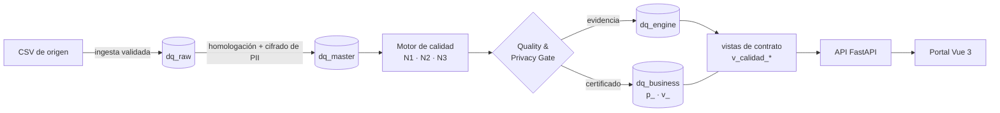

# Smart-DQ · dq-center

Portal de calidad y privacidad de datos para una **aseguradora ficticia**, con datos
100 % sintéticos. Es la implementación del proyecto del curso *Diseño e Implementación
de Sistemas* (USMP, 2026-II, Grupo 6): las historias HU-01 a HU-15 del Product Backlog
están en los [issues](https://github.com/GabouLC/dq-center/issues), y las decisiones
técnicas frente al Documento de Arquitectura, en [docs/adr](docs/adr/README.md).

## Qué hace

Cada fin de mes llegan archivos CSV de cinco sistemas de origen: personas, pólizas,
vehículos, siniestros y pagos. Cada corte pasa por una tubería de etapas:



| Etapa | Qué hace | Historia |
|---|---|---|
| Ingesta | Valida encabezado, campos por línea y UTF-8. Un archivo inválido se rechaza y queda registrado; uno válido llega a RAW sin cambios. | HU-01 |
| Homologación | Renombra al modelo estándar y convierte tipos según `config/homologacion.yaml`, sin corregir valores. Lo que no se puede convertir va a incidencias. | HU-14 |
| Privacy Gate | Cifra los campos `SENSIBLE_CIFRADO` del contrato: el DNI con cifrado determinístico y nombres, correo y celular con cifrado aleatorio (AEAD). | HU-05, HU-06 |
| Motor | 36 reglas (48 al expandir las transversales) en tres niveles: N1 básicas, N2 de negocio y N3 de la carga. El SQL se genera a partir del tipo de cada regla. | HU-02, HU-03 |
| Certificación | Una regla CRÍTICA o ALTA en FAIL, o PII en texto claro, impide certificar. Cada veredicto lleva sello: corrida, versión del motor y versión de las reglas. | HU-04, HU-07 |
| Publicación | Solo los cortes certificados llegan a `dq_business.p_<tabla>`; `v_<tabla>` muestra el último. | HU-08 |
| Portal | Resumen, validaciones, certificación integral, fuentes, contrato, linaje, glosario, reglas, ejecuciones, usuarios y auditoría. | HU-09 a HU-13, HU-15 |

### Roles

| Rol | Puede |
|---|---|
| lector | Ver indicadores. Los campos Sensibles aparecen ocultos y cada ocultamiento queda auditado. |
| gobierno | Además, ver los campos Sensibles y editar el glosario. |
| admin | Además, configurar reglas, lanzar corridas y administrar usuarios y la auditoría. |

Los campos Sensible cifrado (PII) no se muestran en claro a nadie: ni el portal ni
BUSINESS los tienen descifrados. El motor los descifra solo dentro de su propia consulta
(ADR 0007).

### Cómo se verifica

El generador siembra errores conocidos y los anota en un manifiesto: archivos mal
formados, valores no convertibles, defectos para cada regla y una fuga de PII. La
prueba de aceptación corre los 6 cortes y exige que la ingesta, la homologación, las
reglas y la revisión de privacidad detecten **exactamente** lo sembrado. Pasa igual en
DuckDB (local y CI) y en BigQuery.

## Correrlo en local

Requisitos: Python 3.12 y Node 24. No hace falta GCP.

```bash
python -m venv .venv
.venv/Scripts/pip install -e ".[datagen,local,api,dev]"     # en Linux/Mac: .venv/bin/pip

.venv/Scripts/python -m dqc.datagen                          # genera data/landing y el manifiesto
.venv/Scripts/python -m dqc.pipeline --db data/dq.duckdb     # flujo completo + verificación
.venv/Scripts/python -m dqc.api                              # API en http://127.0.0.1:8000

cd web && npm install && npm run dev                         # portal en http://localhost:5173
```

**Inicio de sesión.** Se entra con correo y contraseña (ADR 0011). En local hay tres
cuentas de demostración, una por rol, con la contraseña `SmartDQ-2026` (se cambia con
`DQC_CLAVE_DEMO`):

| Cuenta | Rol | Qué ve |
|---|---|---|
| `admin@demo.local` | Administrador | Todo, más reglas, corridas, usuarios y auditoría |
| `gobierno@demo.local` | Gobierno de datos | Los módulos de consulta, con los campos sensibles |
| `lector@demo.local` | Lector | Los módulos de consulta, con los campos sensibles ocultos |

Un administrador da acceso desde *Usuarios y roles*. La cuenta nueva recibe una
contraseña temporal que debe cambiar al entrar. Cinco intentos fallidos bloquean la
cuenta 15 minutos.

La configuración local vive en `data/config_local.json` y el secreto que firma las
sesiones, en `data/secreto_sesiones`. La API mantiene abierto `data/dq.duckdb`:
detenla antes de volver a correr `dqc.pipeline`.

Pruebas: `.venv/Scripts/python -m pytest -q` (105 pruebas) y `npm run build` en `web/`.

## Correrlo en GCP

Proyecto `dq-center-gabou`, región `us-central1` y BigQuery en `US`. Mientras el
proyecto no tenga facturación activa, todo corre en el **sandbox** de BigQuery
(ADR 0008): sin particiones, con tablas que vencen a los 60 días.

```bash
export DQC_PROYECTO=dq-center-gabou DQC_SANDBOX=1
gcloud auth login --update-adc

python -m dqc.gcp preparar                        # datasets y llaves de cifrado
python -m dqc.gcp sembrar --admin tu@correo.com   # reglas, contratos, glosario y admins (imprime su clave temporal)
python -m dqc.gcp simular                         # 6 cortes desde cero + verificación
python -m dqc.gcp ejecutar                        # reevalúa el último corte

DQC_MODO=gcp DQC_SECRETO=... python -m dqc.api    # API sobre BigQuery + Firestore
```

En Cloud Run, `DQC_SECRETO` sale de Secret Manager (`openssl rand -base64 48`).

**Opcional: entrar también con Google (Firebase).** Se agrega con `DQC_AUTH=firebase` y
se configura una sola vez en la consola:

1. En Firebase, agrega Firebase al proyecto `dq-center-gabou` (plan Spark, gratuito).
2. En *Authentication › Sign-in method*, habilita el proveedor Google.
3. En *Configuración del proyecto › Tus apps*, registra una app web y copia su
   configuración a `web/.env.local`:

   ```
   VITE_FIREBASE_API_KEY=...
   VITE_FIREBASE_AUTH_DOMAIN=dq-center-gabou.firebaseapp.com
   VITE_FIREBASE_PROJECT_ID=dq-center-gabou
   ```

**Despliegue en Cloud Run (pendiente).** Hace falta facturación activa: Cloud Run,
Artifact Registry y Cloud Scheduler no funcionan en el sandbox. El plan es
publicar la API y la web como dos servicios, y el motor como Cloud Run Job con
Scheduler diario (ADR 0003). La variable `DQC_JOB` ya permite que el portal lance ese
job a demanda.

## Costos

| Servicio | Uso | Costo mensual |
|---|---|---|
| BigQuery | Unos cientos de MB consultados por corrida | USD 0 (capa gratuita: 1 TB de consultas y 10 GB de almacenamiento) |
| Firestore | Configuración y auditoría, cientos de lecturas al día | USD 0 (capa gratuita) |
| Cloud Run (API, web y job) | Escala a cero | USD 0 a 1 (capa gratuita) |
| Artifact Registry | Conserva las últimas 5 imágenes | Centavos |
| Cloud Scheduler | 1 job diario | USD 0 (3 jobs gratis) |
| **Total** | | **USD 0 a 1** |

El Documento de Arquitectura estimaba USD 30 a 45, sobre todo por Cloud SQL. Los ADR
0002 a 0005 explican cada sustitución.

## Estructura

```
config/          reglas, contratos con DAC, homologación de fuentes y glosario
src/dqc/
  datagen/       generador de datos sintéticos y zona de aterrizaje
  pipeline/      ingesta, homologación, privacidad, publicación y el flujo por corte
  motor/         reglas, SQL por tipo, puntuación y certificación
  plataforma/    DuckDB (local) y BigQuery, con la misma interfaz
  api/           API FastAPI del portal e inicio de sesión
  gcp/           Firestore y la línea de comandos de GCP
web/             portal en Vue 3 + TypeScript + Pinia (MVVM)
tests/           105 pruebas, incluida la de aceptación contra el manifiesto
docs/            brief original y decisiones de arquitectura (ADR)
```

## Equipo

Gabriel León (Data Enabler, líder) · Jesus de la Cruz (Data Architect) · Cristhian
Pimentel (Data Engineer) · Franco Delgado (QA Specialist) · Josue Borda (Full-Stack
Developer). Docente: Ing. Juan Manuel Huapalla García.
