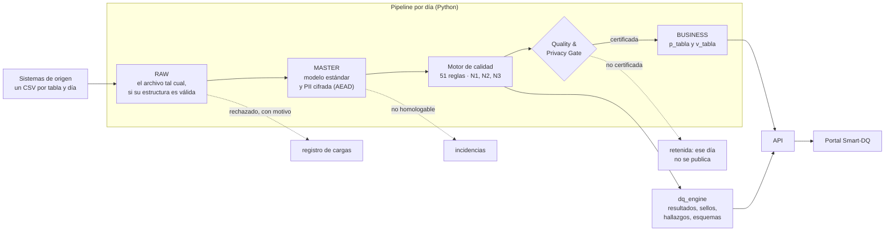
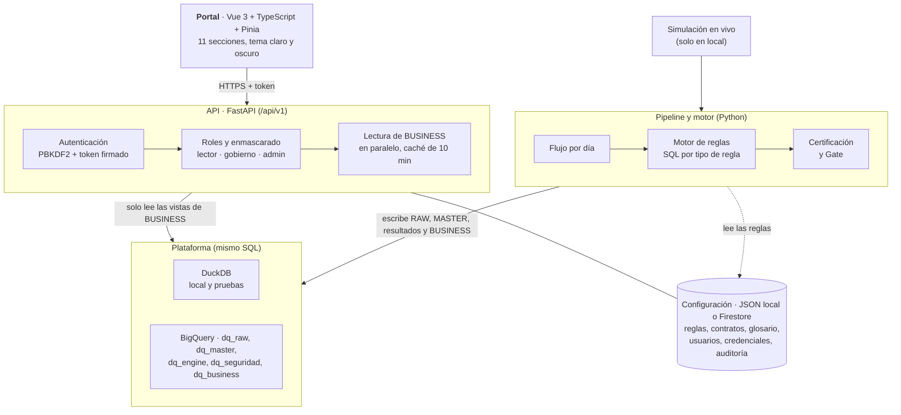
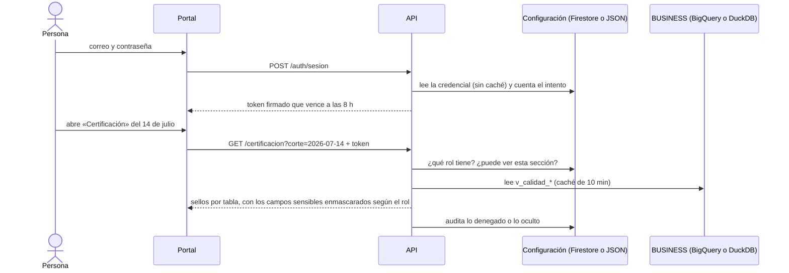

# Arquitectura de Smart-DQ

Cómo está armado el sistema hoy, en una página. Cada decisión que se apartó del *Documento de
Arquitectura v1.0* del curso tiene su ADR en [docs/adr](adr/README.md); aquí se enlazan.

## En una frase

Cada día llega un archivo por tabla; Smart-DQ lo carga, lo ordena, cifra los datos personales,
le aplica 51 reglas de calidad y solo deja pasar al negocio lo que supera el control de calidad y
privacidad. El portal muestra el veredicto de cada día y de cada tabla.

## El recorrido de los datos

- **Tres capas** ([ADR 0006](adr/0006-capas-y-privacy-gate.md)): RAW conserva el original, MASTER lo
  homologa y lo protege, BUSINESS expone solo lo certificado. El portal **solo lee BUSINESS**.
- **El Gate certifica por tabla y por día:** una regla CRÍTICA o ALTA en falla, un dato personal sin
  cifrar o un archivo que no llegó dejan la tabla sin certificar.
- Los registros que no se pueden homologar no se corrigen: quedan como incidencias.

## Componentes

| Pieza | Qué hace | Decisión |
|---|---|---|
| Pipeline y motor | Ingesta, homologación, reglas, Gate y publicación; un día a la vez | [ADR 0003](adr/0003-orquestacion.md), [0004](adr/0004-evaluacion-sql.md) |
| Plataforma | El mismo SQL corre en DuckDB (local y pruebas) y en BigQuery (GCP) | [ADR 0010](adr/0010-pruebas.md), [0008](adr/0008-sandbox.md) |
| API | Autentica, aplica el rol, enmascara los campos y lee solo las vistas de BUSINESS | [ADR 0005](adr/0005-sin-api-gateway.md), [0011](adr/0011-inicio-de-sesion.md), [0016](adr/0016-roles-de-la-aplicacion.md) |
| Portal | Muestra el día elegido: resumen, validaciones, certificación, fuentes, contrato, linaje, glosario y administración | [ADR 0002](adr/0002-stack.md), [0015](adr/0015-indicador-pass.md) |
| Datos | Sintéticos, con errores sembrados y un manifiesto que dice cuáles son | [ADR 0009](adr/0009-datos-sinteticos.md), [0012](adr/0012-cortes-diarios.md) |
| Simulación en vivo | Los archivos de los últimos días llegan uno por uno y el portal se actualiza solo | [ADR 0013](adr/0013-simulacion-en-vivo.md) |

## Un inicio de sesión y una pantalla

## Seguridad y privacidad

| Qué se protege | Cómo | Dónde |
|---|---|---|
| Datos personales (DNI, nombres, correo, celular) | Se cifran al pasar a MASTER (determinístico para el DNI, aleatorio para el resto); el motor descifra solo en memoria lo que cada regla usa | [ADR 0007](adr/0007-pii-solo-en-memoria.md) |
| Quién entra | Correo y contraseña (PBKDF2, 600 000 iteraciones), bloqueo a los 5 intentos, contraseña temporal que obliga a cambiarla | [ADR 0011](adr/0011-inicio-de-sesion.md) |
| Qué ve cada rol | Los campos SENSIBLE se ocultan al lector y SENSIBLE_CIFRADO nunca sale en claro; cada acceso denegado u oculto queda en la auditoría | [ADR 0016](adr/0016-roles-de-la-aplicacion.md) |
| El repositorio | CodeQL, gitleaks sobre el historial, Dependabot, plantilla de PR y protección de `main` | [ADR 0017](adr/0017-controles-del-repositorio.md), [SECURITY.md](../SECURITY.md) |

## Atributos de calidad del propio sistema

| Atributo | Cómo se logra | Cómo se comprueba |
|---|---|---|
| Correctitud | Los errores se siembran a propósito y el flujo tiene que encontrar exactamente esos | La verificación contra el manifiesto da 0 y 0 en cuatro etapas ([pipeline-local.txt](evidencias/pipeline-local.txt)) |
| Portabilidad | El mismo SQL en DuckDB y en BigQuery | Paridad fila por fila entre las dos ([bigquery.txt](evidencias/bigquery.txt)) |
| Rendimiento (HU-15) | Lecturas en paralelo, caché de 10 minutos que se renueva en segundo plano sin que nadie espere, y precarga al arrancar; cabecera `Server-Timing` | Mediciones por sección, en frío y bajo carga ([rendimiento.txt](evidencias/rendimiento.txt)) |
| Accesibilidad | Teclado, foco visible, contraste AA, tema oscuro, movimiento reducido | Pruebas e2e en el CI ([accesibilidad-y-e2e.txt](evidencias/accesibilidad-y-e2e.txt)) |
| Trazabilidad | Cada sello lleva la ejecución, la versión del motor y la del catálogo de reglas | Tabla `dq_engine.certificaciones` y la sección Certificación |

## Dónde corre

| Entorno | Qué usa | Estado |
|---|---|---|
| Local | DuckDB, configuración en JSON, cuentas de demostración | Funciona; es el que se demuestra ([AGENTS.md](../AGENTS.md)) |
| GCP | BigQuery en modo sandbox y Firestore, proyecto `dq-center-gabou` | Funciona (92 días cargados, acceso probado contra Firestore real) |
| Cloud Run | La API y el portal publicados | Pendiente: depende de la facturación de GCP, que no se pudo crear ([ADR 0008](adr/0008-sandbox.md)) |
