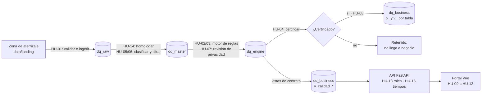

# Guía de despliegue y trazabilidad de Smart-DQ

Esta guía responde tres preguntas:

1. ¿Cómo se despliega el proyecto, paso a paso?
2. ¿Qué hace cada parte del proyecto cuando se despliega?
3. ¿Dónde y cómo se cumple cada historia de usuario (HU-01 a HU-15)?

**Verificada el 27 de octubre de 2026** sobre `main` (commit `9f90c6a`): 127 pruebas en verde, el
build del portal sin errores, y cada prueba, captura y archivo que se cita aquí existe en el
repositorio. Las referencias apuntan a archivos y funciones, no a números de línea, que cambian
con cada pull request.

Para instalar desde un clon limpio, con todas las comprobaciones, usa [AGENTS.md](../AGENTS.md).
Esta guía explica qué pasa por dentro en cada paso.

**Contenido**

1. [El recorrido del dato](#1-el-recorrido-del-dato)
2. [Despliegue local, paso a paso](#2-despliegue-local-paso-a-paso)
3. [Despliegue en GCP (sandbox), paso a paso](#3-despliegue-en-gcp-sandbox-paso-a-paso)
4. [Qué hace cada componente](#4-qué-hace-cada-componente)
5. [API, portal y roles](#5-api-portal-y-roles)
6. [Dónde y cómo se cumple cada HU](#6-dónde-y-cómo-se-cumple-cada-hu)
7. [Desviaciones respecto del documento del curso](#7-desviaciones-respecto-del-documento-del-curso)
8. [Qué falta para cerrar el Sprint 3](#8-qué-falta-para-cerrar-el-sprint-3)

---

## 1. El recorrido del dato



| # | Etapa | Qué pasa | Dónde queda | HU |
|---|---|---|---|---|
| 1 | Generación | `dqc.datagen` crea los CSV sintéticos de 7 fuentes para 92 días (1 de julio a 30 de septiembre de 2026), el calendario de entregas y un manifiesto con los errores que siembra a propósito | `data/landing/`, `data/landing/entregas.json`, `data/manifiesto_errores.parquet` | Insumo (ADR 0009, 0012) |
| 2 | Ingesta | Cada archivo se valida. Si está bien, entra a RAW tal cual llegó; si no, se rechaza con su motivo | `dq_raw.<fuente>`, `dq_raw.registro_cargas` | HU-01 |
| 3 | Homologación y cifrado | Se renombran columnas y se convierten tipos según `homologacion.yaml`. La PII se cifra según la clasificación DAC del contrato | `dq_master.<tabla>`, `dq_master.incidencias_homologacion` | HU-14, HU-05, HU-06 |
| 4 | Motor de reglas | Corre 48 reglas como SQL: N1 (completitud, unicidad, validez), N2 (consistencia, integridad) y N3 (oportunidad, volumetría). La PII se descifra solo dentro de la consulta | `dq_engine.resultados`, `fallidos`, `esquemas` | HU-02, HU-03 |
| 5 | Revisión de privacidad | Busca campos sin cifrar, PII en claro y columnas sin clasificar | `dq_engine.hallazgos_privacidad` | HU-07 |
| 6 | Certificación | Da un veredicto por tabla y corte, con un sello de trazabilidad | `dq_engine.certificaciones` | HU-04, HU-07 |
| 7 | Publicación | Solo lo certificado pasa a negocio | `dq_business.p_<tabla>` y `dq_business.v_<tabla>` | HU-08 |
| 8 | Vistas de contrato | Exponen los resultados del motor, las cargas y las incidencias para el portal | `dq_business.v_calidad_*` | HU-08 |
| 9 | API | Lee solo las vistas `v_calidad_*`, aplica los roles y mide los tiempos | `src/dqc/api` | HU-09 a HU-13, HU-15 |
| 10 | Portal | Muestra cada sección según el rol de quien entra | `web/` | HU-09 a HU-13, HU-15 |

---

## 2. Despliegue local, paso a paso

Todo corre en tu PC con DuckDB: no hace falta GCP, credenciales ni conexión a ninguna base. Los
comandos son de PowerShell (Windows). En macOS o Linux cambia `.venv\Scripts\python` por
`.venv/bin/python`.

### Paso 1 · Instalar (unos 2 minutos)

```powershell
git clone https://github.com/GabouLC/dq-center.git
cd dq-center
py -3.12 -m venv .venv
.venv\Scripts\python -m pip install -e ".[datagen,local,api,dev]"
```

- **Qué hace:** crea el entorno `.venv/` e instala el paquete `dqc` con los extras de
  `pyproject.toml`: generador de datos, DuckDB, API y pruebas.
- **Cómo se comprueba:** AGENTS.md, paso 2.

### Paso 2 · Generar los datos sintéticos (unos 25 segundos)

```powershell
.venv\Scripts\python -m dqc.datagen
```

- **Qué hace por dentro:** `datagen/generador.py` (`generar`) arma, con una semilla fija, una
  aseguradora ficticia y siembra errores conocidos. `datagen/exportar.py` (`exportar`) escribe
  los archivos.
- **Qué deja creado:**
  - `data/landing/<AAAA-MM-DD>/`: 463 CSV en total. Son 5 fuentes diarias durante 92 días, más
    `productos` y `ubigeos` solo el 1 de julio, más un reenvío de siniestros el 28 de julio.
  - `data/landing/entregas.json`: a qué hora llega cada archivo.
  - `data/manifiesto_errores.parquet`: qué error se sembró, dónde y en qué etapa. Así se puede
    comprobar que el sistema detecta exactamente lo sembrado (ADR 0010).
- **Cómo se comprueba:** imprime una tabla de errores por regla (AGENTS.md, paso 3).
- **HU:** insumo de todas.

### Paso 3 · Correr el pipeline (unos 4 minutos)

```powershell
.venv\Scripts\python -m dqc.pipeline --db data/dq.duckdb --hasta 2026-09-24
```

- **Qué hace por dentro:** `pipeline/__main__.py` reinicia la base (conserva las llaves) y, por
  cada uno de los 86 cortes del 1 de julio al 24 de septiembre, `pipeline/flujo.py`
  (`procesar_corte`) hace en orden:

  | Etapa | Función | Escribe en | HU |
  |---|---|---|---|
  | Ingerir | `Flujo.ingerir` → `ingesta.validar_csv` | `dq_raw.<fuente>` y `dq_raw.registro_cargas` | HU-01 |
  | Homologar y cifrar | `Flujo.homologar` → `homologacion.sql_homologacion` | `dq_master.<tabla>` (PII en BYTES) e `incidencias_homologacion` | HU-14, HU-05, HU-06 |
  | Evaluar | `Flujo.evaluar` → `motor.Motor.ejecutar` | `dq_engine.resultados`, `fallidos`, `esquemas` | HU-02, HU-03 |
  | Revisar privacidad | `privacidad.revisar` | `dq_engine.hallazgos_privacidad` | HU-07 |
  | Certificar | `certificacion.certificar` | `dq_engine.certificaciones` (con sello) | HU-04, HU-07 |
  | Publicar | `publicacion.publicar` | `dq_business.p_<tabla>` (solo lo certificado) | HU-08 |
  | Cerrar la corrida | `motor.guardar_ejecucion` | `dq_engine.ejecuciones` | HU-04 |

  Al final, `pipeline/verificacion.py` (`verificar`) compara lo detectado con el manifiesto.
- **Qué deja creado:** `data/dq.duckdb`, con un esquema por capa:

  | Esquema | Objetos |
  |---|---|
  | `dq_raw` | `clientes`, `polizas`, `vehiculos`, `siniestros`, `cobranzas`, `productos`, `ubigeos` (todo como texto, más `fecha_corte` y `archivo`) y `registro_cargas` |
  | `dq_master` | `persona`, `poliza`, `vehiculo`, `siniestro`, `pago`, `ref_producto`, `ref_ubigeo` e `incidencias_homologacion` |
  | `dq_engine` | `ejecuciones`, `resultados`, `fallidos`, `esquemas`, `certificaciones` y `hallazgos_privacidad` |
  | `dq_seguridad` | `llaves`: una determinística y una aleatoria |
  | `dq_business` | tablas `p_persona`, `p_poliza`, `p_vehiculo`, `p_siniestro`, `p_pago`; vistas `v_persona` … `v_pago` (último corte certificado de cada tabla); y las vistas de contrato `v_calidad_ejecuciones`, `_resultados`, `_fallidos`, `_esquemas`, `_certificaciones`, `_hallazgos_privacidad`, `_cargas` e `_incidencias` |

- **Por qué hasta el 24 de septiembre:** los 30 archivos del 25 al 30 quedan pendientes para la
  simulación en vivo del paso 4 (ADR 0013).
- **Cómo se comprueba:** las últimas líneas dicen `0 sin detectar 0 detectados de más`.
- **Ojo:** sin `--db`, la base queda en memoria y no se guarda nada.

### Paso 4 · Levantar la API (primera terminal)

```powershell
.venv\Scripts\python -m dqc.api
```

- **Qué hace por dentro:** levanta FastAPI en `127.0.0.1:8000` (`api/__main__.py`), y luego:
  - Crea `data/config_local.json` **solo si no existe**, con las reglas, los contratos, el
    glosario y las cuentas demo tomados de `config/*.yaml`, y `data/secreto_sesiones` para
    firmar las sesiones.
  - Lee **solo** las vistas `dq_business.v_calidad_*` (`api/datos.py`, `FuenteBusiness`), con
    una caché de 10 minutos y precarga al arrancar (HU-08, HU-15).
  - Arranca el simulador en vivo (`api/vivo.py`): llega un archivo cada 20 segundos. Cuando el
    día está completo, se homologa, se evalúa y se publica, y el portal se actualiza solo (HU-09).
    Los 30 archivos tardan unos 10 minutos.
  - Mide cada solicitud: si una tarda más de 8 segundos, queda en la auditoría como
    `RENDIMIENTO_LENTO` (HU-15).
- **Cómo se comprueba:** `http://127.0.0.1:8000/health/readiness` responde `{"estado":"ok"}`. La
  documentación interactiva de la API está en `http://127.0.0.1:8000/api/v1/docs`.
- **Ojo:**
  - Mientras la API está arriba tiene el DuckDB abierto: para volver a correr el pipeline,
    detenla primero.
  - Las reglas que cambies desde el portal se guardan en `data/config_local.json`; el pipeline
    del paso 3 sigue usando `config/reglas_iniciales.yaml`.

### Paso 5 · Levantar el portal (segunda terminal)

```powershell
cd web
npm ci
npm run dev
```

- **Qué hace por dentro:** Vite sirve el portal Vue 3 en `http://localhost:5173` y envía `/api`
  y `/health` a la API (o a la dirección que pongas en la variable `DQC_API`).
- **Cómo se comprueba:** entra con una cuenta demo (`admin@demo.local`, `gobierno@demo.local` o
  `lector@demo.local`). La contraseña está en AGENTS.md, paso 5. Cada rol ve un menú distinto
  (sección 5).

### Paso 6 · Verificar (unos 2 minutos)

```powershell
.venv\Scripts\python -m pytest -q
cd web; npm run build
```

- **Qué hace por dentro:** las pruebas generan sus propios datos a escala reducida (22 días) y
  recorren todo el flujo en DuckDB con el mismo SQL que en BigQuery (ADR 0010). El build revisa
  los tipos (`vue-tsc`) y arma el portal.
- **Resultado al 27/10/2026:** `127 passed` y `✓ built`.
- **CI:** `.github/workflows/ci.yml` corre estas dos verificaciones en cada pull request y en cada
  push a `main`. No despliega nada ni toca GCP.

---

## 3. Despliegue en GCP (sandbox), paso a paso

Proyecto `dq-center-gabou`: la región es `us-central1` y BigQuery está en `US`. Mientras el
proyecto no tenga facturación activa, todo corre en el **sandbox** de BigQuery (ADR 0008): sin
particiones, con tablas agrupadas por `fecha_corte` y que vencen a los 60 días.

```powershell
.venv\Scripts\python -m pip install -e ".[datagen,local,gcp,api,dev]"
$env:DQC_PROYECTO = "dq-center-gabou"; $env:DQC_SANDBOX = "1"
gcloud auth login --update-adc
.venv\Scripts\Activate.ps1    # los comandos de la tabla usan el python del entorno
```

Hace falta tener `data/` generado con `dqc.datagen` (sección 2, paso 2) y acceso al proyecto en GCP.

| Paso | Comando | Qué hace por dentro | Qué crea | HU |
|---|---|---|---|---|
| 1 | `python -m dqc.gcp preparar` | `plataforma/bigquery.py` (`PlataformaBigQuery.preparar`) crea los datasets y las llaves de cifrado | Datasets `dq_raw`, `dq_master`, `dq_engine`, `dq_seguridad` y `dq_business` en `US`; tabla `dq_seguridad.llaves` con una llave determinística (AES-SIV) y una aleatoria (AES-GCM) | HU-06 |
| 2 | `python -m dqc.gcp sembrar --admin <correo>` | `gcp/firestore.py` (`sembrar`) carga la configuración en Firestore. Sin `--reemplazar` no pisa lo que ya existe | Colecciones `reglas`, `contratos`, `glosario`, `usuarios` y `credenciales`. Imprime la contraseña temporal del admin. `auditoria` aparece con el primer evento | HU-03, HU-05, HU-10, HU-13 |
| 3 | `python -m dqc.gcp simular` | Borra las tablas de las capas, sin tocar las llaves, y procesa los 92 cortes con el mismo flujo de la sección 2, en 8 hilos, verificando contra el manifiesto. Las reglas salen de Firestore (o del YAML con `--reglas-yaml`) | Las mismas tablas y vistas que en local, ahora en BigQuery. Tarda unas 9 horas | HU-01 a HU-08, HU-14 |
| 4 | `python -m dqc.gcp simular --desde 2026-09-08` | Si la carga se cortó, quita los cortes desde esa fecha y sigue desde ahí (ADR 0014) | Completa lo que faltaba | — |
| 5 | `python -m dqc.gcp ejecutar` | Reevalúa el último corte con las reglas y contratos de Firestore | Una corrida nueva en `dq_engine` | HU-04 |
| 6 | `python scripts/evidencia_bigquery.py` | **Solo lee.** Hace un dry run, se detiene si la consulta pasaría de 1 GB y compara fila por fila con `data/dq_completo.duckdb` | `docs/evidencias/bigquery.txt` (última corrida: 83,4 MB leídos y 0 diferencias) | Evidencia de todas |
| 7 | `$env:DQC_MODO = "gcp"; $env:DQC_SECRETO = "<secreto>"; python -m dqc.api` | La API lee BigQuery y Firestore. Las cuentas demo quedan apagadas | — | HU-09 a HU-13, HU-15 |

**Límites de seguridad:** cada consulta tiene un tope de 2 GB y nadie escribe en `dq_seguridad`
salvo `preparar`.

**Qué no está desplegado y por qué.** Cloud Run (API y web), el Cloud Run Job con Cloud
Scheduler (ADR 0003), Artifact Registry, Cloud KMS (ADR 0006) y Secret Manager. Todo depende de
activar la facturación del proyecto, que hoy está bloqueada. En el repositorio no hay Dockerfile
ni configuración de Cloud Run. La variable `DQC_JOB` ya deja preparado que el portal lance el job
cuando exista.

**Costos.** BigQuery y Firestore entran en la capa gratuita, y el sandbox no cobra. El README
estima USD 0 a 1 al mes con Cloud Run desplegado; es una estimación del plan, no un gasto actual.

---

## 4. Qué hace cada componente

| Componente | Qué hace | Entra → sale | Capa | HU | ADR |
|---|---|---|---|---|---|
| `config/homologacion.yaml` | Mapea las columnas de cada una de las 7 fuentes al modelo estándar | — | RAW → MASTER | HU-14 | 0006 |
| `config/contratos.yaml` | Declara el tipo, la clasificación DAC y el modo de cifrado de cada campo | — | MASTER | HU-05, HU-06 | 0006 |
| `config/reglas_iniciales.yaml` | Catálogo de 36 reglas: 3 aplican a todas las tablas y se multiplican por 5, así que se evalúan 48 | — | MASTER | HU-02, HU-03 | 0004 |
| `config/glosario.yaml` | 40 términos de negocio con su dominio | — | — | HU-10 | — |
| `src/dqc/modelo.py` | Nombres de capas, esquemas, niveles por dimensión, severidades que bloquean y categorías DAC | — | todas | todas | 0012 |
| `src/dqc/datagen` | Generador de la aseguradora ficticia y de los errores sembrados | semilla → CSV y manifiesto | aterrizaje | insumo | 0009, 0012 |
| `src/dqc/pipeline/ingesta.py` | Valida cada CSV (UTF-8, encabezado, número de campos) | CSV → RAW o rechazo | RAW | HU-01 | 0006 |
| `src/dqc/pipeline/homologacion.py` y `funciones.py` | Genera el SQL de homologación y cifra la PII (AES-SIV o AES-GCM, con `tabla.campo` como dato asociado) | RAW → MASTER e incidencias | MASTER | HU-14, HU-06 | 0006, 0010 |
| `src/dqc/pipeline/privacidad.py` | Revisión de privacidad: `CAMPO_SIN_CIFRAR` y `PII_EN_CLARO` bloquean; `COLUMNA_SIN_CLASIFICAR` queda como observación | MASTER → hallazgos | MASTER | HU-07 | 0006, 0007 |
| `src/dqc/motor` | Valida las reglas, genera un SQL por regla, la puntúa (OK, ALERTA o FALLA) y certifica cada tabla | MASTER → resultados y sellos | ENGINE | HU-02, HU-03, HU-04 | 0004, 0007, 0015 |
| `src/dqc/pipeline/publicacion.py` | Crea las vistas de contrato y publica solo lo certificado | MASTER → BUSINESS | BUSINESS | HU-08 | 0006 |
| `src/dqc/pipeline/flujo.py` | Orquesta cada corte: ingerir, homologar, evaluar, certificar y publicar | — | todas | todas | 0003, 0014 |
| `src/dqc/plataforma` | La misma interfaz para DuckDB (local y pruebas) y BigQuery; el SQL de BigQuery se traduce a DuckDB | — | — | — | 0008, 0010 |
| `src/dqc/api` | API FastAPI: sesiones y roles, enmascarado, simulación en vivo, auditoría y tiempos | vistas → JSON | lee BUSINESS | HU-09 a HU-13, HU-15 | 0002, 0005, 0011, 0013 |
| `src/dqc/gcp` | CLI para BigQuery y Firestore | — | todas | — | 0002, 0008, 0014 |
| `web/` | Portal Vue 3 + TypeScript + Pinia | API → pantallas | — | HU-09 a HU-13, HU-15 | 0005 |
| `scripts/evidencia_bigquery.py` | Evidencia y paridad entre BigQuery y DuckDB | BigQuery → `bigquery.txt` | — | evidencia | 0010 |
| `scripts/capturas_portal.py` | Regenera las capturas con su propia API y su propio portal (puertos 8001 y 5174) | → `docs/evidencias/portal/` | — | evidencia | — |
| `scripts/jira_sync.py` | Sincroniza el Jira del curso; sin `--aplicar` solo muestra lo que haría | — | — | seguimiento | — |

---

## 5. API, portal y roles

### Roles (ADR 0011)

| Rol | Permisos | Qué ve |
|---|---|---|
| Lector | `leer` | Las 7 secciones de consulta. Los campos SENSIBLE aparecen como «•••• restringido» |
| Gobierno | `leer`, `ver_sensibles`, `editar_glosario` | Lo mismo, con los campos SENSIBLE visibles, y puede editar el glosario |
| Admin | lo anterior, más `configurar` y `administrar` | Además: reglas, ejecuciones, usuarios, auditoría y los controles de la simulación |

Los campos SENSIBLE_CIFRADO (DNI, nombres, correo) **no los ve nadie** en el portal: aparecen como
«•••• cifrado» (ADR 0007). El inicio de sesión usa contraseñas PBKDF2, sesiones firmadas que
vencen a las 8 horas, bloqueo de 15 minutos tras 5 intentos fallidos y una contraseña temporal
que hay que cambiar al primer ingreso.

### Pantallas del portal

| Ruta | Qué muestra | Endpoints | Quién | HU |
|---|---|---|---|---|
| `/entrar`, `/clave` | Inicio de sesión y cambio de contraseña obligatorio | `/api/v1/auth/*` | todos | HU-13 |
| `/resumen` | % de reglas en PASS, puntaje, tendencia y lectura rápida del día | `/resumen`, `/certificacion`, `/validaciones/comparar` | los 3 roles | HU-09, HU-15 |
| `/validaciones` | Reglas de un corte, primero las fallas; comparar cortes; muestras de filas que fallaron (enmascaradas) | `/validaciones`, `/validaciones/comparar`, `/validaciones/{regla}/{tabla}/fallidos` | los 3 roles | HU-02, HU-03, HU-09, HU-13 |
| `/certificacion` | Veredicto por tabla y nivel, reglas que bloquean, campos PII protegidos y enlace al linaje | `/certificacion` | los 3 roles | HU-04, HU-07, HU-12 |
| `/fuentes` | Cargas exitosas y rechazadas, e incidencias de homologación | `/fuentes`, `/fuentes/{tabla}/estructura` | los 3 roles | HU-01, HU-14 |
| `/contratos` | Clasificación DAC de cada campo | `/contratos` | los 3 roles | HU-05 |
| `/linaje` | Recorrido RAW → MASTER → BUSINESS, columna por columna, con sus transformaciones | `/linaje/{tabla}`, `/glosario` | los 3 roles | HU-11 |
| `/glosario` | Términos, búsqueda sin tildes y dominio | `/glosario`; `PUT /glosario/{id}` para editar | los 3 roles (edita gobierno y admin) | HU-10 |
| `/reglas` | Crear y editar reglas sin tocar código; el SQL se prueba antes de guardar | `/reglas` | admin | HU-03 |
| `/ejecuciones` | Últimas corridas y lanzar una nueva | `/ejecuciones` | admin | HU-04, HU-09 |
| `/usuarios` | Altas, roles y contraseñas temporales | `/admin/usuarios` | admin | HU-13 |
| `/auditoria` | Accesos denegados, accesos a datos restringidos y solicitudes lentas | `/admin/auditoria` | admin | HU-13, HU-15 |

Reglas comunes:
- Sin sesión, el portal te lleva a `/entrar`; con contraseña temporal, a `/clave`; y si tu rol no
  tiene una sección, a la primera que sí tienes.
- Con la sesión abierta, el estado en vivo se consulta cada 4 segundos.
- Los errores de la API salen como `{statusCode, error, message}`.

---

## 6. Dónde y cómo se cumple cada HU

Los criterios de aceptación salen del cuerpo de cada issue de GitHub, que copia el Product
Backlog del curso. **Estado** dice si el criterio tiene implementación y prueba; la aceptación
formal la da el Product Owner en la revisión del sprint.

### Resumen

| HU | Título | Sprint | Issue | Criterios | Prueba principal |
|---|---|---|---|---|---|
| HU-01 | Ingestar datos sintéticos en RAW | 1 | cerrado | 4/4 | `tests/test_flujo.py::test_lo_rechazado_no_llega_a_raw_y_queda_registrado` |
| HU-02 | Validaciones de calidad N1 | 1 | cerrado | 4/4 | `tests/test_motor.py::test_cada_corte_evalua_las_48_reglas_con_su_nivel` |
| HU-03 | Reglas de calidad N2 | 2 | cerrado | 4/4 | `tests/test_certificacion.py::test_la_certificacion_dice_que_reglas_la_bloquean` |
| HU-04 | Certificar la calidad | 2 | cerrado | 4/4 (c con una salvedad) | `tests/test_certificacion.py::test_matriz_de_certificacion` |
| HU-05 | Clasificar según la taxonomía DAC | 1 | cerrado | 4/4 | `tests/test_flujo.py::test_dni_nombres_y_correo_son_sensibles_cifrados` |
| HU-06 | Cifrar los datos sensibles | 1 | cerrado | 3/4 y 1 desviación documentada | `tests/test_flujo.py::test_ningun_campo_pii_queda_en_texto_plano_en_master` |
| HU-07 | Quality & Privacy Gate | 2 | cerrado | 4/4 | `tests/test_certificacion.py::test_una_fuga_de_pii_bloquea_aunque_la_calidad_este_bien` |
| HU-08 | Publicar lo certificado en BUSINESS | 2 | cerrado | 4/4 (d con un matiz) | `tests/test_certificacion.py::test_business_solo_tiene_cortes_certificados` |
| HU-09 | Visualizar el estado de calidad | 3 | abierto | 4/4 | `tests/test_api.py::test_resumen_muestra_tendencia_pass_y_certificacion` |
| HU-10 | Consultar el glosario | 3 | abierto | 4/4 | `tests/test_api.py::test_glosario_busca_sin_tildes_y_filtra_por_dominio` |
| HU-11 | Consultar el linaje | 3 | abierto | 4/4 y 1 refinamiento pendiente | `tests/test_api.py::test_linaje_de_persona_de_raw_a_business` |
| HU-12 | Certificación integral del dato | 3 | abierto | 4/4 y 1 refinamiento pendiente | `tests/test_api.py::test_certificacion_integral_del_dia_de_la_fuga` |
| HU-13 | Acceso a datos sensibles por roles | 3 | abierto | 3/4 y 1 parcial | `tests/test_api.py::test_campos_sensibles_ocultos_para_el_lector_y_visibles_para_gobierno` |
| HU-14 | Homologar hacia MASTER | 1 | cerrado | 4/4 | `tests/test_flujo.py::test_los_registros_no_homologables_quedan_fuera_de_master` |
| HU-15 | Tiempo de carga del portal | 3 | abierto | 1/4 y 3 parciales | `tests/test_api.py::test_cada_seccion_responde_en_menos_de_8_segundos` |

Las capturas citadas están en `docs/evidencias/portal/`; `bigquery.txt` y `pipeline-local.txt`, en
`docs/evidencias/`.

### HU-01 · Ingestar datos sintéticos en la capa RAW

| Criterio | Dónde | Cómo | Prueba | Evidencia | Estado |
|---|---|---|---|---|---|
| a) Un CSV válido se carga en RAW | `pipeline/ingesta.py` (`validar_csv`); `pipeline/flujo.py` (`Flujo.ingerir`) | Revisa encabezado, número de campos y UTF-8, y escribe en `dq_raw.<fuente>` | `tests/test_ingesta.py::test_archivo_valido_se_carga_tal_cual` | `hu01-fuentes-persona-llegadas.png`; `bigquery.txt` (462 cargas exitosas) | Cumplido |
| b) Los registros no se modifican | `pipeline/ingesta.py` | Todo se guarda como texto, sin recortar espacios; solo se agregan `fecha_corte` y `archivo` | `tests/test_flujo.py::test_raw_conserva_los_valores_tal_cual_vienen` | La prueba | Cumplido |
| c) La carga correcta queda como EXITOSA | `pipeline/ingesta.py`; `Flujo.ingerir` | Cada archivo deja una fila en `dq_raw.registro_cargas` con estado, filas y hora | `tests/test_flujo.py::test_lo_rechazado_no_llega_a_raw_y_queda_registrado` | Pantalla Fuentes; `hu01-fuentes-persona-llegadas.png` | Cumplido |
| d) Un error de formato rechaza la carga y la registra | `pipeline/ingesta.py` (`validar_csv`) | Rechaza columnas faltantes o repetidas, filas con otro número de campos, archivo vacío o no UTF-8. Lo rechazado no entra a RAW, pero queda registrado con su motivo | `tests/test_ingesta.py::test_estructura_invalida_se_rechaza`; `tests/test_flujo.py::test_archivo_mal_formado_se_rechaza_con_su_motivo` | `hu01-fuentes-siniestro-rechazo.png` | Cumplido |

### HU-02 · Ejecutar validaciones de calidad de Nivel 1

| Criterio | Dónde | Cómo | Prueba | Evidencia | Estado |
|---|---|---|---|---|---|
| a) Se ejecutan las pruebas N1 | `motor/motor.py` (`Motor.ejecutar`); `modelo.py` (`NIVEL_POR_DIMENSION`) | Un SQL por regla de completitud, unicidad o validez, sobre cada corte | `tests/test_motor.py::test_cada_corte_evalua_las_48_reglas_con_su_nivel` | `bigquery.txt` (19 reglas N1 por corte) | Cumplido. Corre sobre MASTER, no sobre RAW como dice el issue, porque así lo piden HU-14 c) y el ADR 0006 |
| b) Lo que cumple queda en PASS | `motor/puntuacion.py` (`estado`) | La regla queda en OK (PASS) si alcanza su umbral | `tests/test_reglas.py::test_estado_segun_umbral` | `hu02-hu03-validaciones-14-julio.png` | Cumplido. PASS y FAIL son por regla, no por registro |
| c) Lo que no cumple queda en FAIL con su observación | `motor/motor.py` | Guarda cada llave que falla en `dq_engine.fallidos` y una muestra de hasta 20 filas | `tests/test_motor.py::test_muestras_traen_la_fila_sin_exponer_pii`; `tests/test_flujo.py::test_cada_etapa_detecta_exactamente_lo_sembrado` | `hu13-validaciones-gobierno.png` | Cumplido. ALERTA y FALLA cuentan como FAIL |
| d) Queda el estado de cada regla | `motor/motor.py` → `dq_engine.resultados` | Una fila por regla y corte, con universo, cumplimiento y estado | `tests/test_motor.py::test_hay_reglas_en_ok_alerta_y_falla` | `pipeline-local.txt` | Cumplido |

### HU-03 · Ejecutar reglas de calidad de Nivel 2

| Criterio | Dónde | Cómo | Prueba | Evidencia | Estado |
|---|---|---|---|---|---|
| a) El motor evalúa las reglas N2 configuradas | `modelo.py`; `config/reglas_iniciales.yaml`; `motor/reglas.py` (`validar`); pantalla Reglas | 14 reglas de consistencia e integridad. Se crean o editan sin tocar código, y el SQL se prueba (dry run) antes de guardar | `tests/test_motor.py::test_catalogo_tiene_36_reglas_y_48_expandidas`; `tests/test_api.py::test_admin_cambia_un_umbral_y_queda_auditado`; `tests/test_api.py::test_una_regla_invalida_o_con_sql_roto_no_se_guarda` | `hu03-reglas-configurables.png` | Cumplido |
| b) Si cumple, PASS | `motor/puntuacion.py` (`estado`) | Igual que HU-02 b) | `tests/test_reglas.py::test_estado_segun_umbral` | `hu02-hu03-validaciones-14-julio.png` | Cumplido |
| c) Si no cumple, FAIL con observación | `motor/motor.py` | Igual que HU-02 c) | `tests/test_motor.py::test_hay_reglas_en_ok_alerta_y_falla` | `pipeline-local.txt` | Cumplido |
| d) Se ven las reglas que impiden certificar | `motor/certificacion.py` (`reglas_bloqueantes`); pantalla Certificación | Una regla CRÍTICA o ALTA en FALLA queda listada como bloqueante | `tests/test_certificacion.py::test_la_certificacion_dice_que_reglas_la_bloquean` | `hu04-hu12-certificacion-30-septiembre.png` | Cumplido |
| Backlog: reglas por dominio Póliza y Persona | `modelo.py` (`DOMINIO_POR_TABLA`) | Cada resultado lleva su dominio | `tests/test_certificacion.py::test_los_resultados_se_asocian_a_los_dominios_poliza_y_persona` | `hu04-hu07-hu12-certificacion-7-agosto.png` | Cumplido |

### HU-04 · Certificar la calidad de los datos

| Criterio | Dónde | Cómo | Prueba | Evidencia | Estado |
|---|---|---|---|---|---|
| a) Se consolidan los niveles | `motor/certificacion.py` (`certificar`) | Un veredicto por tabla y corte que junta N1, N2, N3 y privacidad | `tests/test_certificacion.py::test_matriz_de_certificacion` | `hu04-hu12-certificacion-30-septiembre.png` | Cumplido |
| b) Si las reglas requeridas pasan, se certifica | `motor/certificacion.py` | Tres estados: CERTIFICADO, CERTIFICADO_CON_OBSERVACIONES (también se publica) y NO_CERTIFICADO | `tests/test_certificacion.py::test_una_media_en_falla_no_bloquea`; `tests/test_certificacion.py::test_vehiculo_certifica_sin_observaciones_despues_de_la_limpieza` | `bigquery.txt` (452 de 460 sellos certificados) | Cumplido |
| c) Si una requerida falla, no se certifica | `motor/certificacion.py`; `modelo.py` (`SEVERIDADES_BLOQUEANTES`) | Una regla CRÍTICA o ALTA en FALLA, un hallazgo de privacidad bloqueante o un archivo que no llegó da NO_CERTIFICADO | `tests/test_certificacion.py::test_la_certificacion_dice_que_reglas_la_bloquean`; `tests/test_certificacion.py::test_una_tabla_cuyo_archivo_no_llego_no_se_certifica` | `bigquery.txt` | Cumplido, con una salvedad: la banda de ALERTA deja pasar hasta 2 puntos bajo el umbral sin bloquear, incluso en reglas CRÍTICAS. La decisión está pendiente del PO en [auditoria-reglas.md](auditoria-reglas.md) |
| d) El resultado queda registrado | `motor/certificacion.py`; `Flujo` → `dq_engine.certificaciones` | Cada sello guarda corrida, versión del motor, versión del catálogo de reglas, cobertura y hora | `tests/test_certificacion.py::test_cada_certificacion_lleva_su_sello` | `hu04-ejecuciones.png` | Cumplido |

### HU-05 · Clasificar datos según la taxonomía DAC

| Criterio | Dónde | Cómo | Prueba | Evidencia | Estado |
|---|---|---|---|---|---|
| a) Los campos de Póliza y Persona tienen categoría | `config/contratos.yaml` (clave `dac`); `pipeline/configuracion.py` (`cargar_contratos`) | La clasificación se declara en el contrato y se rechaza una categoría inválida. Una columna nueva sin clasificar se marca y se trata como SENSIBLE | `tests/test_firestore.py::test_los_contratos_cubren_las_tablas_con_sus_tipos_reales` | `hu05-contrato-dac.png` | Cumplido (clasificación declarativa, no detección automática) |
| b) Lo público queda como Público | `config/contratos.yaml` (por ejemplo, `tipo_documento`) | — | `tests/test_flujo.py::test_dni_nombres_y_correo_son_sensibles_cifrados` | `hu05-contrato-dac.png` | Cumplido |
| c) Lo restringido queda como Sensible | `config/contratos.yaml` (montos, placa y otros) | — | La misma prueba | `hu05-contrato-dac.png` | Cumplido |
| d) DNI, nombre y correo quedan como Sensible Cifrado | `config/contratos.yaml`; `cargar_contratos` exige que solo estos tengan modo de cifrado | — | La misma prueba; `tests/test_api.py::test_contrato_con_dac_y_columna_fuera_de_contrato` | `hu05-contrato-dac.png` | Cumplido |

### HU-06 · Cifrar automáticamente los datos sensibles

| Criterio | Dónde | Cómo | Prueba | Evidencia | Estado |
|---|---|---|---|---|---|
| a) La PII se cifra en el Privacy Gate | `pipeline/homologacion.py`; `pipeline/funciones.py` | Se cifra en la misma consulta que lleva de RAW a MASTER | `tests/test_flujo.py::test_ningun_campo_pii_queda_en_texto_plano_en_master` | `bigquery.txt` (campos en BYTES) | Cumplido |
| b) Lo que se compara usa cifrado determinístico | `config/contratos.yaml`; `pipeline/funciones.py` (AES-SIV) | El mismo DNI da el mismo cifrado, así que la regla de unicidad funciona sin descifrar | `tests/test_flujo.py::test_deterministico_iguala_documentos_y_aleatorio_no`; `tests/test_flujo.py::test_el_dni_en_master_no_coincide_con_raw_pero_se_descifra_igual` | `hu06-hu11-linaje-campo-cifrado.png` | Cumplido |
| c) Lo demás usa cifrado no determinístico | `pipeline/funciones.py` (AES-GCM) | — | `tests/test_flujo.py::test_deterministico_iguala_documentos_y_aleatorio_no` | `bigquery.txt` | Cumplido |
| d) La PII no queda en texto plano al almacenarse | MASTER y BUSINESS guardan BYTES; `pipeline/privacidad.py` (hallazgo `CAMPO_SIN_CIFRAR`) | — | `tests/test_flujo.py::test_ningun_campo_pii_queda_en_texto_plano_en_master`; `tests/test_certificacion.py::test_business_no_expone_pii_en_claro` | `bigquery.txt` | **Desviación documentada (ADR 0006):** RAW guarda la PII en claro porque es la zona de aterrizaje, y las llaves viven en `dq_seguridad.llaves`, no en Cloud KMS |

### HU-07 · Ejecutar el Quality & Privacy Gate

| Criterio | Dónde | Cómo | Prueba | Evidencia | Estado |
|---|---|---|---|---|---|
| a) El Gate valida calidad y privacidad en MASTER | `Flujo.evaluar` (motor, `revisar` y `certificar`); `pipeline/privacidad.py` (`revisar`) | Hay tres hallazgos de privacidad: dos bloquean y uno es observación | `tests/test_certificacion.py::test_una_fuga_de_pii_bloquea_aunque_la_calidad_este_bien`; `tests/test_certificacion.py::test_columna_nueva_sin_clasificar_es_observacion` | `bigquery.txt` | Cumplido |
| b) Si cumple, queda habilitado para BUSINESS | `motor/certificacion.py`; `pipeline/publicacion.py` | Todo lo que no es NO_CERTIFICADO se publica | `tests/test_certificacion.py::test_cada_certificacion_lleva_su_sello` | `bigquery.txt` | Cumplido |
| c) Si falla una validación obligatoria, no se certifica | `motor/certificacion.py` | Un hallazgo bloqueante deja NO_CERTIFICADO aunque la calidad esté bien | `tests/test_certificacion.py::test_una_fuga_de_pii_bloquea_aunque_la_calidad_este_bien` | `hu04-hu07-hu12-certificacion-7-agosto.png` | Cumplido |
| d) Queda evidencia | `dq_engine.certificaciones` y `hallazgos_privacidad` | — | `tests/test_certificacion.py::test_cada_certificacion_lleva_su_sello`; `tests/test_flujo.py::test_cada_etapa_detecta_exactamente_lo_sembrado` | `bigquery.txt` | Cumplido |

### HU-08 · Publicar datos certificados en BUSINESS

| Criterio | Dónde | Cómo | Prueba | Evidencia | Estado |
|---|---|---|---|---|---|
| a) Lo aprobado queda en BUSINESS | `pipeline/publicacion.py` (`publicar`) | Copia el corte de MASTER a `p_<tabla>`, con la PII todavía cifrada | `tests/test_certificacion.py::test_business_solo_tiene_cortes_certificados` | `bigquery.txt` | Cumplido |
| b) Lo no aprobado no se expone | `pipeline/publicacion.py` | Quita el corte antes de republicar y salta lo no certificado | `tests/test_certificacion.py::test_business_solo_tiene_cortes_certificados`; `tests/test_certificacion.py::test_reevaluar_un_corte_que_deja_de_certificar_lo_saca_de_business` | `bigquery.txt` | Cumplido |
| c) Se consulta con las vistas de BUSINESS | `pipeline/publicacion.py` (`v_<tabla>` y `v_calidad_*`) | — | `tests/test_certificacion.py::test_la_vista_de_cada_tabla_muestra_su_ultimo_corte_certificado`; `tests/test_certificacion.py::test_las_vistas_de_contrato_responden` | `bigquery.txt` | Cumplido |
| d) El portal solo accede a BUSINESS | `api/datos.py` (`FuenteBusiness`) | Todas las lecturas de la API van contra `dq_business` | `tests/test_api.py::test_el_portal_solo_lee_la_capa_business` | — | Cumplido para las lecturas. Matiz: al guardar una regla, la API prueba su SQL contra MASTER, y en local corre el motor y la simulación dentro del proceso |

### HU-09 · Visualizar el estado de calidad de los datos

| Criterio | Dónde | Cómo | Prueba | Evidencia | Estado |
|---|---|---|---|---|---|
| a) El dashboard muestra el estado de las reglas | `GET /api/v1/resumen` y `/validaciones`; `web/src/vistas/Resumen.vue` y `Validaciones.vue` | % de reglas en PASS (ADR 0015), puntaje, tendencia, mapa de días y tabla de reglas | `tests/test_api.py::test_resumen_muestra_tendencia_pass_y_certificacion`; `tests/test_api.py::test_validaciones_de_un_corte_empiezan_por_las_fallas` | `hu09-resumen.png` | Cumplido |
| b) Se identifican las reglas en PASS | `Resumen.vue`; `componentes/EstadoChip.vue` («Cumple»); filtro en Validaciones | — | `tests/test_api.py::test_resumen_muestra_tendencia_pass_y_certificacion` | `hu09-resumen.png` | Cumplido |
| c) Se identifican las reglas en FAIL | `EstadoChip.vue`; la API ordena primero las fallas | — | `tests/test_api.py::test_validaciones_de_un_corte_empiezan_por_las_fallas`; `tests/test_api.py::test_comparar_cortes_muestra_primero_lo_que_empeoro` | `hu02-hu03-validaciones-14-julio.png` | Cumplido |
| d) Tras una ejecución nueva, se actualiza | La API invalida su caché; `web/src/stores/vivo.ts` consulta cada 4 s | — | `tests/test_api.py::test_admin_lanza_una_corrida_y_aparece_en_el_portal`; `tests/test_vivo.py::test_el_dia_siguiente_llega_archivo_por_archivo` | `hu09-actividad-en-vivo.png`; `hu09-panel-en-vivo.png` | Cumplido en la API. La recarga en el navegador no tiene prueba automática |

### HU-10 · Consultar el glosario de negocio

| Criterio | Dónde | Cómo | Prueba | Evidencia | Estado |
|---|---|---|---|---|---|
| a) Se ven los términos | `config/glosario.yaml` (40 términos); `GET /api/v1/glosario`; `vistas/Glosario.vue` | — | `tests/test_api.py::test_glosario_busca_sin_tildes_y_filtra_por_dominio` | `hu10-glosario-busqueda.png` | Cumplido |
| b) Al elegir un término se ve su definición | `GET /api/v1/glosario/{id}`; `Glosario.vue` | — | La misma prueba (indirecta) | `hu10-glosario-busqueda.png` | Cumplido |
| c) La búsqueda muestra coincidencias | `api/vistas.py` | Busca sin distinguir tildes ni mayúsculas, también en sinónimos y definiciones | La misma prueba | `hu10-glosario-busqueda.png` | Cumplido |
| d) Se ve el dominio de cada término | `api/vistas.py`; `Glosario.vue` (con enlace al linaje de los campos) | — | La misma prueba | — | Cumplido |

### HU-11 · Consultar el linaje de los datos

| Criterio | Dónde | Cómo | Prueba | Evidencia | Estado |
|---|---|---|---|---|---|
| a) Se ve el recorrido entre capas | `GET /api/v1/linaje/{tabla}`; `api/vistas.py`; `vistas/Linaje.vue` | Se arma a partir de `homologacion.yaml` y de los contratos | `tests/test_api.py::test_linaje_de_persona_de_raw_a_business` | `hu11-linaje.png` | Cumplido |
| b) Se ve el paso de RAW a MASTER | `api/vistas.py` | Columna de la fuente → campo de MASTER (por ejemplo, `NUM_DOC` → `nro_documento`) | La misma prueba | `hu06-hu11-linaje-campo-cifrado.png` | Cumplido |
| c) Si está certificado, se ve su exposición en BUSINESS | `api/vistas.py`; `Linaje.vue` | Muestra los cortes publicados y los retenidos | La misma prueba | `hu11-linaje.png` | Cumplido |
| d) Se ven las transformaciones | `api/vistas.py` | Renombrar, convertir tipo y cifrar | La misma prueba | `hu06-hu11-linaje-campo-cifrado.png` | Cumplido |
| Refinamiento del Sprint 2: el motivo de cada día no publicado | — | Hoy solo se muestran las fechas retenidas | — | — | **Pendiente** |

### HU-12 · Consultar la certificación integral del dato

| Criterio | Dónde | Cómo | Prueba | Evidencia | Estado |
|---|---|---|---|---|---|
| a) Se ve si está certificado o no | `GET /api/v1/certificacion`; `vistas/Certificacion.vue` (sello y mapa de días) | — | `tests/test_api.py::test_certificacion_integral_del_dia_de_la_fuga` | `hu04-hu07-hu12-certificacion-7-agosto.png` | Cumplido |
| b) Con reglas fallidas, «no certificado» y sus observaciones | `api/vistas.py`; `Certificacion.vue` | — | La misma prueba (caso de fuga de PII); `tests/test_certificacion.py::test_la_certificacion_dice_que_reglas_la_bloquean` | `hu04-hu12-certificacion-30-septiembre.png` | Cumplido |
| c) Se verifica que la PII está protegida | `api/vistas.py` (`campos_cifrados`) | Un campo cuenta como protegido si está guardado en BYTES | La misma prueba | `hu04-hu07-hu12-certificacion-7-agosto.png` | Cumplido |
| d) Se llega al linaje y a los resultados de calidad | `Certificacion.vue` (enlace «Ver su linaje» y calidad por nivel en la ficha) | — | La misma prueba | Las mismas capturas | Cumplido |
| Refinamiento del Sprint 2: el último corte certificado que ve negocio | — | No implementado | — | — | **Pendiente** |

### HU-13 · Controlar el acceso a datos sensibles mediante roles (IAM)

| Criterio | Dónde | Cómo | Prueba | Evidencia | Estado |
|---|---|---|---|---|---|
| a) Un campo Sensible se asocia a un rol autorizado | DAC en `config/contratos.yaml`; permiso `ver_sensibles` en `api/app.py`; roles en `api/configuracion.py` y Firestore | La asociación es por categoría DAC, con roles de la aplicación | `tests/test_api.py::test_cada_rol_ve_solo_sus_modulos` | `hu13-usuarios.png` | **Parcial:** son roles de la aplicación, no IAM de GCP (no hay ACL por dataset ni etiquetas de política por columna), y ningún ADR lo registra |
| b) Con el rol autorizado se ve el campo | `api/vistas.py` (`enmascarar`) | Gobierno y admin ven lo SENSIBLE; lo SENSIBLE_CIFRADO no lo ve nadie | `tests/test_api.py::test_campos_sensibles_ocultos_para_el_lector_y_visibles_para_gobierno` | `hu13-validaciones-gobierno.png` | Cumplido |
| c) Sin el rol se restringe | Lo mismo, más 403 por sección y la guarda de `web/src/router.ts` | — | La misma prueba; `tests/test_api.py::test_incidencias_ocultan_los_valores_sensibles_al_lector`; `tests/test_api.py::test_un_lector_no_puede_administrar` | `hu13-validaciones-lector.png` | Cumplido |
| d) El acceso denegado queda auditado | `api/app.py` (`ACCESO_DENEGADO`, `ACCESO_RESTRINGIDO`); pantalla Auditoría | — | `tests/test_api.py::test_un_lector_no_puede_administrar`; `tests/test_api.py::test_cuenta_sin_rol_responde_403_y_queda_auditada` | `hu13-auditoria-acceso-denegado.png` | Cumplido |
| Refinamiento: inicio de sesión, bloqueo y contraseña temporal (ADR 0011) | `api/autenticacion.py`; `Entrar.vue`, `CambiarClave.vue`, `Usuarios.vue` | — | `tests/test_autenticacion.py`; `tests/test_api.py::test_la_contrasena_temporal_sin_cambiar_queda_auditada` | `hu13-login.png` | Cumplido en local; falta probarlo contra Firestore |

### HU-14 · Homologar el modelo de datos hacia la capa MASTER

| Criterio | Dónde | Cómo | Prueba | Evidencia | Estado |
|---|---|---|---|---|---|
| a) RAW se transforma al modelo de MASTER | `config/homologacion.yaml`; `pipeline/homologacion.py` (`sql_homologacion`); `Flujo.homologar` | Genera el SQL por fuente y corte a partir del YAML, y convierte tipos sin corregir valores | `tests/test_flujo.py::test_la_homologacion_cubre_el_contrato_con_los_mismos_tipos` | `hu14-fuentes-poliza-estructura.png` | Cumplido |
| b) Se unifican los nombres distintos | `config/homologacion.yaml` | Por ejemplo, `NUM_DOC` → `nro_documento` | `tests/test_flujo.py::test_master_usa_los_nombres_estandar` | `hu11-linaje.png` | Cumplido |
| c) Lo homologado queda disponible para N1 y N2 | `motor/sql.py` (MASTER es el dataset del motor); `procesar_corte` homologa y después evalúa | — | `tests/test_motor.py::test_cada_corte_evalua_las_48_reglas_con_su_nivel` | `bigquery.txt` | Cumplido |
| d) Lo no homologable va a incidencias y queda fuera de MASTER | `pipeline/homologacion.py`; `dq_master.incidencias_homologacion` | — | `tests/test_flujo.py::test_los_registros_no_homologables_quedan_fuera_de_master`; `tests/test_flujo.py::test_cada_etapa_detecta_exactamente_lo_sembrado` | `bigquery.txt` | Cumplido |

### HU-15 · Garantizar el tiempo de carga del portal

| Criterio | Dónde | Cómo | Prueba | Evidencia | Estado |
|---|---|---|---|---|---|
| a) Cada sección responde en 8 s o menos | `api/app.py` (middleware con `Server-Timing`); `api/datos.py` (caché y lectura en paralelo) | Mide el tiempo del servidor, no la carga completa en el navegador | `tests/test_api.py::test_cada_seccion_responde_en_menos_de_8_segundos` (8 rutas) | `docs/evidencias/pruebas.txt` | **Parcial:** solo se mide en DuckDB con 22 días; faltan algunas rutas (reglas, ejecuciones, usuarios, auditoría, comparar y fallidos) y la medición en el navegador |
| b) El dashboard carga dentro del límite | `/api/v1/resumen` | — | La misma prueba | — | **Parcial:** falta medirlo sobre BigQuery |
| c) Una carga lenta queda registrada | `api/app.py` (`RENDIMIENTO_LENTO` en la auditoría) | — | `tests/test_api.py::test_una_solicitud_lenta_queda_registrada_en_la_auditoria` | `hu13-hu15-auditoria.png` | Cumplido (del lado del servidor) |
| d) Las pruebas de rendimiento verifican el indicador | La misma prueba | — | La misma prueba | — | **Parcial:** faltan los tiempos medidos sobre BigQuery en la evidencia |

---

## 7. Desviaciones respecto del documento del curso

| Tema | Documento de Arquitectura v1.0 | Lo que se hizo | ADR |
|---|---|---|---|
| Alcance | Plataforma con detección por huella y reconciliación con sistemas legados | Manda el Product Backlog (HU-01 a HU-15) | 0001 |
| Stack | Node 24 + Hapi + TypeORM, con PostgreSQL en Cloud SQL | Python + FastAPI, con Firestore (o un JSON en local) | 0002 |
| Orquestación | Cloud Composer | Cloud Run Job + Scheduler, **aún no desplegado** por falta de facturación; hoy el flujo corre por línea de comandos | 0003 |
| Evaluación | Dataplex más SQL | Un SQL generado por regla | 0004 |
| Puerta de entrada | API Gateway con clave de API | Sin gateway: token y rol en la API, más CORS | 0005 |
| Capas y cifrado | — | RAW → MASTER → BUSINESS con AEAD; llaves en `dq_seguridad.llaves` en lugar de Cloud KMS; RAW guarda la PII en claro | 0006 |
| PII en el motor | — | Se descifra solo en memoria y solo lo que usa cada regla | 0007 |
| Particiones | Tablas particionadas | En el sandbox se agrupan por `fecha_corte`; vencen a los 60 días | 0008, 0014 |
| Datos | — | Aseguradora ficticia y 92 cortes diarios | 0009, 0012 |
| Pruebas | — | DuckDB con el mismo SQL y un manifiesto de errores sembrados | 0010 |
| Autenticación | Firebase con Google | Correo y contraseña propios; Google queda como opción | 0011 |
| Indicador | Puntaje ponderado | El % de reglas en PASS es el indicador principal | 0015 |
| Roles e IAM (HU-13) | Roles o grupos de IAM | Roles de la aplicación (admin, gobierno, lector) | **Falta un ADR** |

---

## 8. Qué falta para cerrar el Sprint 3

Revisión del sprint: 2 de noviembre de 2026. El detalle de tareas está en
[sprints/sprint-3.md](sprints/sprint-3.md).

| HU | Qué falta |
|---|---|
| HU-09 | Recorrer Resumen y Validaciones con teclado y lector de pantalla, y revisar el tema oscuro |
| HU-10 | Agregar los términos «Carné de extranjería» y «Estado de la cuota» al glosario |
| HU-11 | Mostrar el motivo de cada día no publicado |
| HU-12 | Mostrar el último corte certificado cuando una tabla no se publica |
| HU-13 | Probar el inicio de sesión, el bloqueo y el cambio de contraseña contra Firestore; registrar en un ADR que se usan roles de la aplicación en lugar de IAM de GCP |
| HU-15 | Medir cada sección con la API sobre BigQuery, dejar los tiempos en la evidencia y sumar a la prueba las rutas que faltan |
| Todas | Aceptación del Product Owner en la revisión |

**Puntos de atención técnicos:**

- **Reglas pendientes:** SIN-UNI-01, PAG-VAL-01 y PER-VAL-06 están propuestas en
  [auditoria-reglas.md](auditoria-reglas.md), pero no en `config/reglas_iniciales.yaml`. Al
  agregarlas hay que actualizar las pruebas que esperan 36 y 48 reglas, y la versión del catálogo
  en los sellos va a cambiar.
- **Banda de ALERTA (HU-04 c):** una regla CRÍTICA con umbral 100 puede quedar en ALERTA hasta el
  98 % sin bloquear la certificación. Decisión pendiente del PO.
- **Prueba faltante (HU-07):** ninguna prueba hace saltar el hallazgo `CAMPO_SIN_CIFRAR`.
