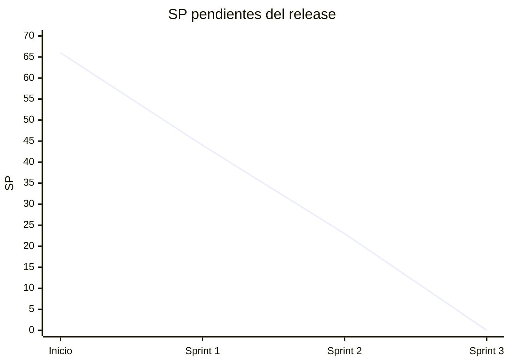

# Sprints de Smart-DQ

Seguimiento Scrum del proyecto (Diseño e Implementación de Sistemas, USMP 2026-II).
Cada sprint tiene un documento con sus cinco partes: planificación, sprint backlog,
seguimiento, revisión con evidencia por criterio de aceptación y retrospectiva.

| Sprint | Objetivo | Historias, en orden de prioridad | SP | Estado | Documento |
|---|---|---|---|---|---|
| 1 | Base del pipeline: RAW, MASTER, DAC, calidad N1 y cifrado | HU-01, HU-14, HU-05, HU-02, HU-06 | 22 | Terminado | [sprint-1.md](sprint-1.md) |
| 2 | Motor y Gate: N2 y N3, certificación, Privacy Gate y BUSINESS | HU-03, HU-04, HU-07, HU-08 | 21 * | Terminado | [sprint-2.md](sprint-2.md) |
| 3 | Portal Smart-DQ: acceso, dashboard, certificación, linaje, glosario y rendimiento | HU-13, HU-09, HU-12, HU-11, HU-10, HU-15 | 23 * | Terminado | [sprint-3.md](sprint-3.md) |

\* Los puntos del Sprint 1 salen del *Sprint 1 Planning* del equipo. Los de los Sprints 2
y 3 son una **propuesta** con la misma escala (Fibonacci, velocidad sugerida 20–24 SP)
y deben confirmarse en la planificación con el equipo.

## Scrum en el proyecto: dónde está cada pieza

Según la Guía Scrum (2020): tres responsabilidades, cinco eventos y tres artefactos, cada uno
con su compromiso. *Listo* significa que el documento existe con datos reales; *lo completa el
equipo* significa que sale de una reunión y el documento trae el formato para registrarla.

| Elemento | Dónde está | Sprint 1 | Sprint 2 | Sprint 3 |
|---|---|---|---|---|
| **Product Owner y Scrum Master** | [Responsables](#responsables) | Lo completa el equipo | Lo completa el equipo | Lo completa el equipo |
| **Developers** | [Responsables](#responsables) | Listo | Listo | Listo |
| **Product Backlog** y su compromiso, el **objetivo del producto** | [product-backlog.md](product-backlog.md) | Listo | Listo | Listo |
| **Sprint Backlog** y su compromiso, el **objetivo del sprint** | Secciones 1 y 2 de cada sprint | Listo | Listo | Listo |
| **Incremento** y su compromiso, la **Definition of Done** | Sección 4 de cada sprint y [Definition of Done](#definition-of-done) | Listo | Listo | Listo |
| **Sprint** (duración, compromiso y resultado) | Encabezado de cada sprint | Listo | Listo | Listo |
| **Sprint Planning** (por qué, qué y cómo) | Sección 1 de cada sprint | Listo, más el *Sprint 1 Planning* del equipo | Listo (puntos propuestos) | Listo (puntos propuestos) |
| **Daily Scrum** | Sección 3 de cada sprint y [plantillas.md](plantillas.md) | Lo completa el equipo | Lo completa el equipo | Lo completa el equipo |
| **Sprint Review** | Sección 4 de cada sprint, con la evidencia de cada criterio | Listo; los comentarios los completa el equipo | Listo; los comentarios los completa el equipo | Listo, con los comentarios recibidos |
| **Sprint Retrospective** | Sección 5 de cada sprint | Borrador con hechos; lo completa el equipo | Borrador con hechos; lo completa el equipo | Borrador con hechos; lo completa el equipo |
| Complementos: Definition of Ready, burndown, impedimentos y velocidad | Este documento y la sección 3 de cada sprint | Listo | Listo | Listo |

## Cómo se priorizó

El Product Backlog no asigna prioridades numéricas, así que el orden sale de tres criterios,
aplicados en este orden:

1. **Dependencias.** No se puede validar lo que no se cargó ni certificar lo que no se
   validó. Por eso el orden por capas es RAW, luego MASTER, luego BUSINESS y al final el portal.
2. **Riesgo.** Lo más complejo y lo de seguridad va primero dentro de cada sprint:
   el cifrado (HU-06, 8 SP) en el Sprint 1, el Gate (HU-07) en el Sprint 2 y el control de
   acceso (HU-13) al inicio del Sprint 3, porque toda pantalla del portal lo necesita.
3. **Valor para el negocio.** El dashboard (HU-09) y la certificación integral (HU-12) van
   antes que el glosario (HU-10). El requisito no funcional de rendimiento (HU-15) cierra el
   release porque se mide sobre todas las pantallas ya construidas.

## Burndown del release

Backlog total: 66 SP en 15 historias.

| Momento | SP comprometidos | SP terminados | SP pendientes |
|---|---|---|---|
| Inicio | | | 66 |
| Fin del Sprint 1 | 22 | 22 | 44 |
| Fin del Sprint 2 | 21 | 21 | 23 |
| Fin del Sprint 3 | 23 | 23 | 0 |

## Definition of Ready

Una historia entra a un sprint cuando:

- tiene rol, objetivo y criterios de aceptación en formato *Dado / Cuando / Entonces*;
- tiene story points y no depende de una historia de un sprint posterior;
- existen los datos sintéticos que la ejercitan (o se crean como tarea del mismo sprint).

## Definition of Done

Una historia está terminada cuando:

- [x] el código está en `main` y el CI de GitHub Actions pasa (pruebas y build de la web);
- [x] cada criterio de aceptación tiene al menos una prueba automatizada;
- [x] la prueba de aceptación contra el manifiesto da 0 diferencias en las cuatro etapas;
- [x] lo que se apartó del Documento de Arquitectura quedó en un ADR (`docs/adr`);
- [x] hay evidencia visual o de datos en `docs/evidencias`;
- [x] el issue de la historia está cerrado y enlaza su evidencia.

## Responsables

| Integrante | Rol en el proyecto | Historias |
|---|---|---|
| Gabriel León | Data Enabler, líder | HU-10 y coordinación |
| Cristhian Pimentel | Data Engineer | HU-01, HU-02 |
| Jesus de la Cruz | Data Architect | HU-14, HU-05, HU-06, HU-13 |
| Franco Delgado | QA Specialist | HU-03, HU-04, HU-07, HU-08 |
| Josue Borda | Full-Stack | HU-09, HU-11, HU-12, HU-15 |

Product Owner y Scrum Master: los define el equipo (por confirmar).

## Eventos del equipo

Las dailies, la conversación de la revisión y la retrospectiva son reuniones del equipo. Cada
sprint trae lo que se sabe de forma objetiva (commits, impedimentos, resultados), y para el
resto está [plantillas.md](plantillas.md): acta de daily, burndown diario y formato de
retrospectiva.

## Evidencia

Todo lo que respalda las revisiones está en [`docs/evidencias`](../evidencias/README.md):
capturas del portal, salida del pipeline, consultas en BigQuery y el reporte de las pruebas.
