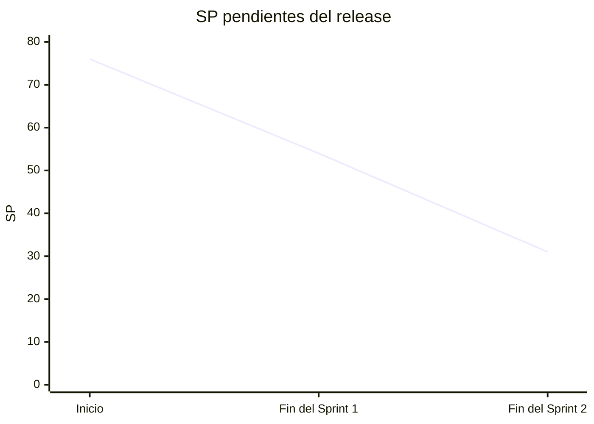

# Sprints de Smart-DQ

Seguimiento Scrum del proyecto (Diseño e Implementación de Sistemas, USMP 2026-II).
Cada sprint tiene un documento con sus cinco partes: planificación, sprint backlog,
seguimiento, revisión con evidencia por criterio de aceptación y retrospectiva.

| Sprint | Objetivo | Historias, en orden de prioridad | SP | Estado | Documento |
|---|---|---|---|---|---|
| 1 | Base del pipeline: RAW, MASTER, DAC, calidad N1 y cifrado | HU-01, HU-14, HU-05, HU-02, HU-06 | 22 | Terminado | [sprint-1.md](sprint-1.md) |
| 2 | Motor y Gate: N2 y N3, certificación, Privacy Gate y BUSINESS | HU-03, HU-04, HU-07, HU-08 | 23 | Terminado | [sprint-2.md](sprint-2.md) |
| 3 | Portal Smart-DQ: acceso, dashboard, certificación, linaje, glosario y rendimiento | HU-13, HU-09, HU-12, HU-11, HU-10, HU-15 | 31 | Planificado: falta su Sprint Planning (prototipo adelantado) | [sprint-3.md](sprint-3.md) |

Los puntos son los que el equipo estimó en el Product Backlog de Jira (proyecto SDGDCYP),
en Fibonacci. El Sprint 3 tiene 31 SP previstos, por encima de la velocidad de los dos primeros
sprints (22 y 23): su Sprint Planning decide si entra todo o si HU-15 pasa a un sprint siguiente.

## Scrum en el proyecto: dónde está cada pieza

Según la Guía Scrum (2020): tres responsabilidades, cinco eventos y tres artefactos, cada uno
con su compromiso. *Listo* significa que el documento existe con datos reales; *lo completa el
equipo* significa que sale de una reunión y el documento trae el formato para registrarla.

| Elemento | Dónde está | Sprint 1 | Sprint 2 | Sprint 3 |
|---|---|---|---|---|
| **Product Owner y Scrum Master** | [Responsables](#responsables) | Listo | Listo | Listo |
| **Developers** | [Responsables](#responsables) | Listo | Listo | Listo |
| **Product Backlog** y su compromiso, el **objetivo del producto** | [product-backlog.md](product-backlog.md) | Listo | Listo | Listo |
| **Sprint Backlog** y su compromiso, el **objetivo del sprint** | Secciones 1 y 2 de cada sprint | Listo | Listo | Objetivo listo; el backlog se arma en su planificación |
| **Incremento** y su compromiso, la **Definition of Done** | Sección 4 de cada sprint y [Definition of Done](#definition-of-done) | Listo | Listo | Pendiente |
| **Sprint** (duración, compromiso y resultado) | Encabezado de cada sprint | Listo | Listo | Listo |
| **Sprint Planning** (por qué, qué y cómo) | Sección 1 de cada sprint | Listo, más el *Sprint 1 Planning* del equipo | Listo | Preliminar; falta confirmarlo |
| **Daily Scrum** | Sección 3 de cada sprint y [dailies.md](dailies.md) | Listo: 4 actas | Listo: 9 actas | Después de su Sprint Planning |
| **Sprint Review** | Sección 4 de cada sprint, con la evidencia de cada criterio | Listo, con asistentes y comentarios | Listo, con asistentes y comentarios | Pendiente; hay comentarios previos sobre el prototipo |
| **Sprint Retrospective** | Sección 5 de cada sprint | Listo, con acciones y responsables | Listo, con el seguimiento de las acciones del Sprint 1 | Al cierre |
| Complementos: Definition of Ready, burndown, impedimentos y velocidad | Este documento y la sección 3 de cada sprint | Listo | Listo | Listo |

## Cómo se priorizó

El Product Backlog no asigna prioridades numéricas, así que el orden sale de tres criterios,
aplicados en este orden:

1. **Dependencias.** No se puede validar lo que no se cargó ni certificar lo que no se
   validó. Por eso el orden por capas es RAW, luego MASTER, luego BUSINESS y al final el portal.
2. **Riesgo.** Lo más complejo y lo de seguridad va primero dentro de cada sprint:
   el cifrado (HU-06, 8 SP) en el Sprint 1, el Gate (HU-07) en el Sprint 2 y el control de
   acceso (HU-13) al inicio del Sprint 3, porque toda pantalla del portal lo necesita.
3. **Valor para el negocio.** El dashboard (HU-09) y la certificación integral (HU-12) van
   antes que el glosario (HU-10). El requisito no funcional de rendimiento (HU-15) cierra el
   release porque se mide sobre todas las pantallas ya construidas.

## Calendario y burndown del release

| Sprint | Fechas | Estado en Jira |
|---|---|---|
| 1 | jueves 1 al lunes 5 de octubre de 2026 | Cerrado |
| 2 | martes 6 al lunes 19 de octubre | Cerrado (en el tablero, el 24 de octubre) |
| 3 | martes 20 de octubre al lunes 2 de noviembre | Sin iniciar: falta su Sprint Planning |

Backlog total: 76 SP en 15 historias. Terminados: 45 SP en dos sprints. Quedan 31 SP, todos del Sprint 3.

| Momento | SP terminados | SP pendientes |
|---|---|---|
| Inicio | | 76 |
| Fin del Sprint 1 (5 de octubre) | 22 | 54 |
| Fin del Sprint 2 (19 de octubre) | 23 (HU-03, HU-04, HU-07 y HU-08) | 31 |

Velocidad: 22 SP en el Sprint 1 y 23 en el Sprint 2.

## Definition of Ready

Una historia entra a un sprint cuando:

- tiene rol, objetivo y criterios de aceptación en formato *Dado / Cuando / Entonces*;
- tiene story points y no depende de una historia de un sprint posterior;
- existen los datos sintéticos que la ejercitan (o se crean como tarea del mismo sprint).

## Definition of Done

Una historia está terminada cuando:

- [x] el código está en `main` y el CI de GitHub Actions pasa (pruebas y build de la web);
- [x] cada criterio de aceptación tiene al menos una prueba automatizada;
- [x] la prueba de aceptación contra el manifiesto da 0 diferencias en las cuatro etapas;
- [x] lo que se apartó del Documento de Arquitectura quedó en un ADR (`docs/adr`);
- [x] hay evidencia visual o de datos en `docs/evidencias`;
- [x] el issue de la historia está cerrado y enlaza su evidencia.

## Responsables

| Integrante | Rol en el proyecto | Historias |
|---|---|---|
| Gabriel León | Data Enabler, líder | HU-10 y coordinación |
| Cristhian Pimentel | Data Engineer | HU-01, HU-02 |
| Jesus de la Cruz | Data Architect | HU-14, HU-05, HU-06, HU-13 |
| Franco Delgado | QA Specialist | HU-03, HU-04, HU-07, HU-08 |
| Josue Borda | Full-Stack | HU-09, HU-11, HU-12, HU-15 |

**Responsabilidades de Scrum**

- **Product Owner:** Gabriel León. Ordena el Product Backlog y acepta cada historia contra sus
  criterios.
- **Scrum Master:** Franco Delgado. Facilita los eventos y hace seguimiento de los impedimentos.
- **Developers:** Cristhian Pimentel, Jesus de la Cruz, Franco Delgado y Josue Borda.

Asistencia: Gabriel, Franco, Jesus y Cristhian asistieron a todos los eventos de los Sprints 1 y
2; Josue Borda no asistió a ninguno.

## Eventos del equipo

Las dailies, la conversación de la revisión y la retrospectiva son reuniones del equipo. Sus
actas se reconstruyeron a partir del tablero de Jira, el orden del Sprint Backlog y los
impedimentos de cada sprint, y así lo indica cada una. Las dailies están en
[dailies.md](dailies.md); la revisión y la retrospectiva, en las secciones 4 y 5 de cada sprint.
El formato de cada evento está en [plantillas.md](plantillas.md).

## Evidencia

Todo lo que respalda las revisiones está en [`docs/evidencias`](../evidencias/README.md):
capturas del portal, salida del pipeline, consultas en BigQuery y el reporte de las pruebas.
