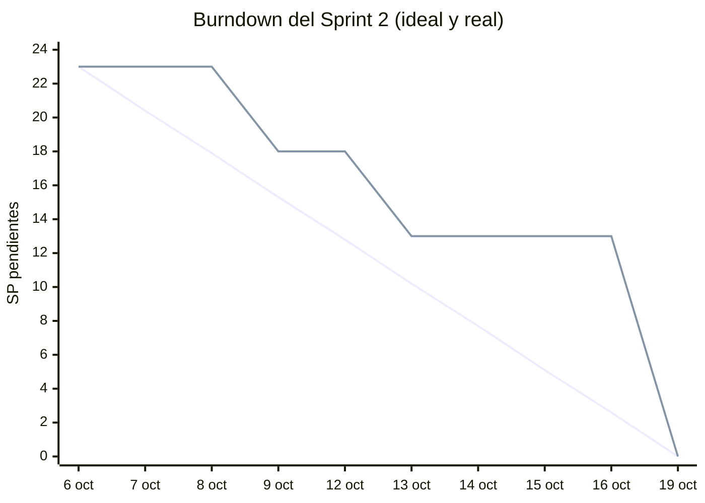

# Sprint 2 · Motor y Gate

**Estado:** terminado · **Fechas:** martes 6 al lunes 19 de octubre de 2026 (dos semanas) ·
**Compromiso:** 23 SP, 4 historias · **Terminado:** 23 SP, 4 historias ·
**Milestone:** [Sprint 2](https://github.com/GabouLC/dq-center/milestone/3) ·
**Jira:** SDGDCYP Sprint 2 (cerrado en el tablero el 24 de octubre) ·
**Incremento:** commit [`565aa0a`](https://github.com/GabouLC/dq-center/commit/565aa0a), más la
reanudación de la carga en BigQuery y su evidencia (24 de octubre)

Las cuatro historias se aceptaron en la revisión del 19 de octubre. Una tarea técnica quedó
abierta al cierre: volver a correr los 92 días en BigQuery, porque la recarga en el sandbox se
cortó a mitad de camino. Se terminó el 24 de octubre, reanudando desde el 8 de septiembre, y la
evidencia de BigQuery se actualizó ese día. Ese mismo día se cerró el sprint en Jira.

## 1. Sprint Planning

**Fecha y duración:** martes 6 de octubre de 2026, reunión virtual de una hora; el sprint dura dos
semanas, hasta el lunes 19 de octubre. **Asistentes:** Gabriel León (Product Owner), Franco Delgado
(Scrum Master), Jesus de la Cruz y Cristhian Pimentel. No asistió Josue Borda.

### ¿Por qué es valioso este sprint? · Objetivo del sprint

**Objetivo del sprint.** Que cada corte salga del pipeline con un veredicto: reglas de Nivel 2
y 3, certificación en tres estados, Quality & Privacy Gate y publicación en BUSINESS solo de
lo certificado.

**Valor.** Al cerrar el sprint, cada tabla de cada corte tiene un veredicto con su porqué, y
BUSINESS expone solo lo que pasó el Gate: el negocio deja de consumir datos sin revisar.

### ¿Qué se puede terminar? · Historias seleccionadas

**Capacidad.** Velocidad sugerida de 20 a 24 SP; el Sprint 1 cerró 22. Se comprometen 23.

**Historias priorizadas.** Los puntos son los del Product Backlog del equipo en Jira.

| # | Historia | SP | Complejidad | Rol del backlog | Responsable | Issue | Estado |
|---|---|---|---|---|---|---|---|
| 1 | HU-03 · Ejecutar reglas de calidad de Nivel 2 | 5 | Media | QA Specialist | Franco Delgado | [#3](https://github.com/GabouLC/dq-center/issues/3) | Aceptada el 9 de octubre |
| 2 | HU-04 · Certificar la calidad de los datos | 5 | Media | QA Specialist | Franco Delgado | [#4](https://github.com/GabouLC/dq-center/issues/4) | Aceptada el 13 de octubre |
| 3 | HU-07 · Ejecutar el Quality & Privacy Gate | 8 | Alta | Data Owner | Franco Delgado | [#7](https://github.com/GabouLC/dq-center/issues/7) | Aceptada el 19 de octubre |
| 4 | HU-08 · Publicar datos certificados en BUSINESS | 5 | Media | Data Owner | Franco Delgado | [#8](https://github.com/GabouLC/dq-center/issues/8) | Aceptada el 19 de octubre |

**Por qué este orden.**

- HU-03 completa los tres niveles de calidad: sin N2 ni N3 no hay nada que certificar.
- HU-04 consolida los resultados de los tres niveles en un veredicto por tabla y corte.
- HU-07 suma la privacidad al veredicto. Es la historia de mayor riesgo, porque une calidad y
  protección, y depende del cifrado del Sprint 1 (HU-06) y de la certificación (HU-04).
- HU-08 va al final: solo se publica lo que el Gate aprobó.

**Fuera del sprint.** El portal, el acceso por rol y el rendimiento (Sprint 3).

### ¿Cómo se hará? · Plan de trabajo

Se completan primero los niveles N2 y N3 del motor, luego la certificación sobre sus
resultados, después la revisión de privacidad que convierte la certificación en el Gate, y al
final la publicación. El manifiesto de errores sembrados se extiende a la etapa de privacidad
para que el Gate tenga la misma prueba de aceptación que el motor.

## 2. Sprint Backlog

Las tareas de cada historia, con su responsable. Al cierre del sprint el tablero quedó así:

| Historias | Tareas por hacer | Tareas hechas |
|---|---|---|
| 4 aceptadas | 0 | 14 de 14 (la corrida en BigQuery, el 24 de octubre) |

**HU-03 · Reglas N2 y N3** · Franco Delgado
- [x] Reglas de consistencia e integridad (N2) y de oportunidad y volumetría (N3); el nivel sale de la dimensión (`NIVEL_POR_DIMENSION` en `src/dqc/modelo.py`)
- [x] Cada resultado lleva su dominio, Póliza o Persona (`DOMINIO_POR_TABLA`)
- [x] Validación de una regla antes de guardarla: tipo, campos y umbral (`src/dqc/motor/reglas.py`)
- [x] Reglas en Firestore, con la versión del catálogo en cada ejecución

**HU-04 · Certificación** · Franco Delgado
- [x] Tres estados: Certificado, Certificado con observaciones y No certificado (`src/dqc/motor/certificacion.py`)
- [x] Una regla CRÍTICA o ALTA en FALLA bloquea; una MEDIA o una ALERTA quedan como observación
- [x] Sello por tabla y corte con versión del motor, versión de reglas y cobertura (`dq_engine.certificaciones`)

**HU-07 · Quality & Privacy Gate** · Franco Delgado
- [x] Revisión de privacidad: DNI, celulares o correos en claro fuera de los campos cifrados, campos PII sin cifrar y columnas nuevas sin clasificar (`src/dqc/pipeline/privacidad.py`)
- [x] Hallazgos guardados como evidencia (`dq_engine.hallazgos_privacidad`)
- [x] Un hallazgo bloqueante impide certificar aunque la calidad esté bien
- [x] Flujo por corte: ingesta, homologación, motor, privacidad, certificación y publicación (`src/dqc/pipeline/flujo.py`)

**HU-08 · Publicación en BUSINESS** · Franco Delgado
- [x] Tablas `p_<tabla>` solo con cortes certificados y vistas `v_<tabla>` con el último certificado (`src/dqc/pipeline/publicacion.py`)
- [x] Vistas de contrato `v_calidad_*`, la única interfaz del portal con los resultados
- [x] Corrida completa en BigQuery: las mismas tablas y vistas en `dq_business`

**Transversal:** datos diarios del 1 de julio al 30 de septiembre, con ruido, tendencias e
incidentes (Cristhian Pimentel), a partir de un comentario de la revisión del Sprint 1.

## 3. Seguimiento · Daily Scrum

**Impedimentos registrados**

| Impedimento | Efecto | Resolución | Estado |
|---|---|---|---|
| Sigue sin facturación en GCP | No hay Cloud Run Job ni Scheduler para la corrida diaria | El flujo corre por línea de comandos; el Job queda listo para cuando haya facturación (ADR 0003) | Abierto |
| La recarga de los 92 cortes en el sandbox de BigQuery tarda unas 9 horas y se cortó a mitad de camino (llegó al 7 de septiembre) | La evidencia de BigQuery seguía con los datos mensuales al cierre del sprint | Nueva opción `--desde`: borra lo que quedó a medias y sigue desde ese corte; verificada con una prueba que reanuda y compara con una corrida de una vez | Resuelto el 24 de octubre |
| DuckDB necesita `pytz` para las fechas con zona horaria | Fallaba el sello de la certificación en local | `pytz` se agregó a las dependencias locales | Resuelto |
| Una consulta de prueba combinaba `QUALIFY` con una agregación, que no es SQL válido | Fallaba la prueba de la última certificación por tabla | Se reescribió con una CTE | Resuelto |

**Burndown.** 23 SP comprometidos y 23 terminados. La línea real sale de las dailies: SP de las
historias que seguían abiertas al final de cada día hábil.

| Día | Fecha | SP ideal | SP real | Historias cerradas ese día |
|---|---|---|---|---|
| 0 | martes 6 de octubre | 23 | 23 | |
| 1 | miércoles 7 | 20,4 | 23 | |
| 2 | jueves 8 | 17,9 | 23 | |
| 3 | viernes 9 | 15,3 | 18 | HU-03 |
| 4 | lunes 12 | 12,8 | 18 | |
| 5 | martes 13 | 10,2 | 13 | HU-04 |
| 6 | miércoles 14 | 7,7 | 13 | |
| 7 | jueves 15 | 5,1 | 13 | |
| 8 | viernes 16 | 2,6 | 13 | |
| 9 | lunes 19 | 0 | 0 | HU-07 y HU-08, en la revisión |



La línea real fue por encima de la ideal hasta el final: HU-07 (8 SP) era la más grande y se
aceptó junto con HU-08 en la revisión. Para el Sprint 3 conviene partir las historias grandes
para que el avance se vea antes.

**Registro de Daily Scrum.** Virtuales, de 15 minutos, a las 8:00 p. m. de cada día hábil.
Asistieron Gabriel León, Franco Delgado, Jesus de la Cruz y Cristhian Pimentel; Josue Borda no
asistió. Las actas completas están en [dailies.md](dailies.md#sprint-2--6-al-19-de-octubre-de-2026).

| Daily | Fecha | Avance del equipo | Impedimentos nuevos |
|---|---|---|---|
| 1 | miércoles 7 de octubre | Reglas N2 del catálogo; nivel de cada regla según su dimensión; refinamiento de HU-04 y HU-07 | Ninguno |
| 2 | jueves 8 | Reglas N3; dominio en cada resultado; diseño de la revisión de privacidad | `pytz` en DuckDB |
| 3 | viernes 9 | Validación de reglas antes de guardarlas; reglas en Firestore; **HU-03 aceptada** | Ninguno; se resolvió `pytz` |
| 4 | lunes 12 | Certificación en tres estados; hallazgos de privacidad como evidencia | Consulta de prueba con `QUALIFY` |
| 5 | martes 13 | Bloqueo por severidad; sello con versiones; **HU-04 aceptada** | Ninguno; se resolvió `QUALIFY` |
| 6 | miércoles 14 | Casos de prueba de privacidad; datos diarios de julio a septiembre | Ninguno |
| 7 | jueves 15 | Prueba de la fuga de PII sobre los datos diarios; recarga de los 92 cortes en BigQuery en marcha | La recarga en el sandbox tarda horas |
| 8 | viernes 16 | Tareas de HU-07 cerradas: el Gate encuentra las 8 fugas sembradas; flujo por corte con privacidad | La recarga de BigQuery se cortó |
| 9 | lunes 19 | Tablas `p_` y vistas `v_` de las cinco tablas; vistas de contrato; criterios de HU-08 revisados | Ninguno |

## 4. Sprint Review e Incremento

**Incremento.** Cada uno de los 92 cortes diarios sale del pipeline con un veredicto por tabla:
48 reglas en tres niveles, revisión de privacidad, sello de certificación y publicación en
BUSINESS solo de lo certificado. En DuckDB y en BigQuery, la verificación contra el manifiesto
da 0 diferencias en las cuatro etapas, y los resultados de BigQuery coinciden fila por fila con
los de DuckDB ([pipeline-local.txt](../evidencias/pipeline-local.txt),
[bigquery.txt](../evidencias/bigquery.txt)).

```bash
python -m dqc.pipeline --db data/dq_completo.duckdb                   # los 92 cortes en local
python -m dqc.gcp --sandbox simular --datos data [--desde AAAA-MM-DD] # en BigQuery; --desde reanuda
python scripts/evidencia_bigquery.py                            # evidencia y paridad con DuckDB
```

**Resultado:** 4 de 4 historias aceptadas, 23 de 23 SP.

### HU-03 · Ejecutar reglas de calidad de Nivel 2

| Criterio de aceptación | Prueba automatizada | Evidencia |
|---|---|---|
| Con reglas configuradas, el motor las evalúa automáticamente | `test_catalogo_tiene_36_reglas_y_48_expandidas`, `test_cada_corte_evalua_las_48_reglas_con_su_nivel` ([test_motor.py](../../tests/test_motor.py)) | 14 reglas N2 y hasta 15 N3 en cada uno de los 92 cortes ([pipeline-local.txt](../evidencias/pipeline-local.txt)) |
| Si los datos cumplen, se registra PASS | `test_estado_segun_umbral` ([test_reglas.py](../../tests/test_reglas.py)) | [Validaciones del 14 de julio](../evidencias/portal/hu02-hu03-validaciones-14-julio.png) |
| Si incumplen, se registra FAIL con observación | `test_hay_reglas_en_ok_alerta_y_falla`, `test_cada_etapa_detecta_exactamente_lo_sembrado` ([test_flujo.py](../../tests/test_flujo.py)) | Reglas fuera de OK por corte en [pipeline-local.txt](../evidencias/pipeline-local.txt) |
| Se identifican las reglas que impiden la certificación | `test_la_certificacion_dice_que_reglas_la_bloquean` ([test_certificacion.py](../../tests/test_certificacion.py)) | Motivo de cada día sin certificar en [pipeline-local.txt](../evidencias/pipeline-local.txt) |
| Las reglas se asocian a los dominios Póliza y Persona (detalle del backlog) | `test_los_resultados_se_asocian_a_los_dominios_poliza_y_persona` | [Certificación](../evidencias/portal/hu04-hu07-hu12-certificacion-7-agosto.png): dominio en cada sello |

### HU-04 · Certificar la calidad de los datos

| Criterio de aceptación | Prueba automatizada | Evidencia |
|---|---|---|
| Se consolidan los resultados de los niveles | `test_matriz_de_certificacion` ([test_certificacion.py](../../tests/test_certificacion.py)) | Barras N1, N2 y N3 de cada sello ([captura](../evidencias/portal/hu04-hu12-certificacion-30-septiembre.png)) |
| Con las reglas requeridas en PASS, los datos quedan certificados | `test_una_media_en_falla_no_bloquea`, `test_matriz_de_certificacion` | 452 de 460 sellos certificados: 31 sin observaciones (Vehículo tras la limpieza, Póliza algunos días de julio) y 421 con observaciones ([pipeline-local.txt](../evidencias/pipeline-local.txt)) |
| Con una regla requerida en FAIL, no se certifican | `test_la_certificacion_dice_que_reglas_la_bloquean` | Persona el 14 y el 22 de julio; Póliza el 20 de agosto y del 28 al 30 de septiembre |
| El resultado se registra para la trazabilidad | `test_cada_certificacion_lleva_su_sello` | Corrida, versión de motor y reglas, cobertura y fecha en cada sello; [Ejecuciones](../evidencias/portal/hu04-ejecuciones.png) |

### HU-07 · Ejecutar el Quality & Privacy Gate

| Criterio de aceptación | Prueba automatizada | Evidencia |
|---|---|---|
| Con datos en MASTER, el Gate valida las reglas de calidad y de privacidad | `test_una_fuga_de_pii_bloquea_aunque_la_calidad_este_bien`, `test_columna_nueva_sin_clasificar_es_observacion` ([test_certificacion.py](../../tests/test_certificacion.py)) | Hallazgos del Gate en BigQuery: 8 registros con PII en claro (7 y 8 de agosto) y `canal_venta` sin clasificar desde el 9 de septiembre ([bigquery.txt](../evidencias/bigquery.txt)) |
| Si cumplen calidad y privacidad, quedan habilitados para BUSINESS | `test_cada_certificacion_lleva_su_sello`, `test_business_solo_tiene_cortes_certificados` | 452 de 460 sellos publicados ([bigquery.txt](../evidencias/bigquery.txt)) |
| Si no cumplen una validación obligatoria, se impide su certificación | `test_una_fuga_de_pii_bloquea_aunque_la_calidad_este_bien`, `test_la_certificacion_dice_que_reglas_la_bloquean` | [Certificación del 7 de agosto](../evidencias/portal/hu04-hu07-hu12-certificacion-7-agosto.png): Siniestro retenido por PII en claro; las 8 tablas-día retenidas con su motivo ([bigquery.txt](../evidencias/bigquery.txt)) |
| Al terminar, se conserva la evidencia para la trazabilidad | `test_cada_certificacion_lleva_su_sello`, `test_cada_etapa_detecta_exactamente_lo_sembrado` ([test_flujo.py](../../tests/test_flujo.py)) | `dq_engine.certificaciones` y `dq_engine.hallazgos_privacidad`: corrida, versiones y fecha de cada sello ([bigquery.txt](../evidencias/bigquery.txt)) |

### HU-08 · Publicar datos certificados en BUSINESS

| Criterio de aceptación | Prueba automatizada | Evidencia |
|---|---|---|
| Lo que aprobó el Gate queda disponible en BUSINESS | `test_business_solo_tiene_cortes_certificados` ([test_certificacion.py](../../tests/test_certificacion.py)) | Cortes publicados por tabla en `dq_business` ([bigquery.txt](../evidencias/bigquery.txt)) |
| Lo que no aprobó no se expone | `test_business_solo_tiene_cortes_certificados`, `test_business_no_expone_pii_en_claro` | Consulta de cortes no certificados en BUSINESS: vacía ([bigquery.txt](../evidencias/bigquery.txt)) |
| Lo publicado se consulta con las vistas y tablas de BUSINESS | `test_la_vista_de_cada_tabla_muestra_su_ultimo_corte_certificado`, `test_las_vistas_de_contrato_responden` | Tablas `p_`, vistas `v_` y vistas de contrato `v_calidad_*` ([bigquery.txt](../evidencias/bigquery.txt)); [Linaje de Persona](../evidencias/portal/hu11-linaje.png) |
| El portal accede solo a BUSINESS | `test_el_portal_solo_lee_la_capa_business` ([test_api.py](../../tests/test_api.py)) | La API lee solo las vistas de contrato (`src/dqc/api/datos.py`) |

### Definition of Done por historia

| Criterio de la Definition of Done | HU-03 | HU-04 | HU-07 | HU-08 |
|---|---|---|---|---|
| Código en `main` y CI en verde | Sí | Sí | Sí | Sí |
| Cada criterio de aceptación con prueba automatizada | 4 de 4, más el detalle de dominios | 4 de 4 | 4 de 4 | 4 de 4 |
| 0 diferencias contra el manifiesto | Reglas | No aplica: la matriz se verifica con `test_matriz_de_certificacion` | Privacidad: 8 de 8 fugas | No aplica: se verifica con las pruebas de BUSINESS |
| Desvíos del documento de arquitectura en un ADR | [0004](../adr/0004-evaluacion-sql.md) | No hubo | [0006](../adr/0006-capas-y-privacy-gate.md), [0007](../adr/0007-pii-solo-en-memoria.md) | [0006](../adr/0006-capas-y-privacy-gate.md), [0008](../adr/0008-sandbox.md) |
| Evidencia en `docs/evidencias` | Sí | Sí | Sí | Sí; la de BigQuery, desde el 24 de octubre |
| Issue cerrado y enlazado a su evidencia | [#3](https://github.com/GabouLC/dq-center/issues/3) | [#4](https://github.com/GabouLC/dq-center/issues/4) | [#7](https://github.com/GabouLC/dq-center/issues/7) | [#8](https://github.com/GabouLC/dq-center/issues/8) |

Las cuatro historias cumplen la Definition of Done: forman el incremento del Sprint 2.

### Reunión de revisión

*Acta reconstruida a partir del tablero de Jira, las dailies y los impedimentos del sprint.*

- **Fecha y duración:** lunes 19 de octubre de 2026, después de la daily; 45 minutos, virtual.
- **Asistentes:** Gabriel León (Product Owner), Franco Delgado (Scrum Master), Jesus de la Cruz y
  Cristhian Pimentel. No asistió Josue Borda.
- **Historias demostradas y aceptadas:** las cuatro. HU-03 y HU-04 ya estaban aceptadas; se
  mostraron sobre los 92 días. Franco mostró el Gate reteniendo Siniestro el 7 y el 8 de agosto
  por PII en claro; Cristhian, las tablas `p_` y las vistas `v_` con el último corte certificado;
  Jesus, que el portal solo lee las vistas de contrato. Gabriel, como Product Owner, aceptó HU-07
  y HU-08 contra sus criterios.

**Comentarios recibidos**

| Quién | Comentario | Qué se hizo |
|---|---|---|
| Gabriel León (PO) | Que el Gate retenga una tabla con la calidad en verde por una fuga de PII es justo lo que pide HU-07. | HU-07 aceptada |
| Jesus de la Cruz | `canal_venta` llega sin estar en el contrato: el Gate la marca como observación, pero alguien tiene que acordarla con el dueño de Póliza. | Queda como tarea de gobierno de datos, fuera de las historias |
| Cristhian Pimentel | Negocio tiene que ver por qué una tabla quedó retenida y desde qué día está viendo el último sello bueno. | Criterio de refinamiento de HU-12 y HU-11 para el Sprint 3 |
| Franco Delgado | La evidencia de BigQuery todavía es la de los datos mensuales; la demostración depende de DuckDB. | Tarea técnica abierta al cierre; se terminó el 24 de octubre |

**Product Backlog tras la revisión.** Sin historias nuevas. HU-12 y HU-11 suman el motivo de la
retención y el último corte certificado visible para negocio. Siguen, en orden, las historias del
Sprint 3: HU-13, HU-09, HU-12, HU-11, HU-10 y HU-15.

## 5. Sprint Retrospective

*Acta reconstruida a partir de los hechos del sprint y de las dailies.*

**Fecha y asistentes:** lunes 19 de octubre de 2026, después de la revisión; 30 minutos. La facilitó
Franco Delgado (Scrum Master). Asistieron Gabriel León, Jesus de la Cruz y Cristhian Pimentel; no
asistió Josue Borda.

**Seguimiento de las acciones del Sprint 1**

| Acción | Resultado |
|---|---|
| Confirmar con Josue Borda su disponibilidad y sus historias | No respondió; no asistió a ningún evento del Sprint 2 |
| Un pull request por historia, vinculado a su issue | No se cumplió: el código siguió entrando directo a `main` |
| Probar cada función nueva en los dos motores al empezar la historia | Se cumplió: lo de `pytz` apareció el segundo día y no al final |
| Escalar la facturación de GCP con soporte | Sin respuesta; sigue abierto |

| Empezar a hacer | Dejar de hacer | Continuar haciendo |
|---|---|---|
| Partir las historias de 8 SP en partes que se puedan aceptar antes del cierre (Franco) | Dejar los procesos largos sin forma de reanudarlos: la recarga de BigQuery se cortó y había que empezar de cero (Gabriel) | Exigir 0 diferencias contra el manifiesto, ahora también en privacidad (Franco) |
| Repartir las historias del Sprint 3 según quién asiste (Cristhian) | Integrar directo a `main` sin que otro integrante revise (Jesus) | Probar en DuckDB y en BigQuery desde el primer día (Jesus) |
| | | Dailies cortas, con los impedimentos anotados el mismo día (Cristhian) |

**Acciones**

| Acción | Responsable | Para cuándo |
|---|---|---|
| Reasignar en la Sprint Planning las historias de Josue Borda (HU-09, HU-11, HU-12 y HU-15) si no confirma su participación | Franco Delgado (SM) | Sprint Planning del Sprint 3, 20 de octubre |
| Reanudar la carga de BigQuery desde donde se cortó, sin empezar de cero | Gabriel León (PO) | Hecho el 24 de octubre (`--desde`) |
| Un pull request por historia, revisado por otro integrante | Franco Delgado (SM) | Desde el Sprint 3 |
| Escalar la facturación de GCP; sin ella, el portal se demuestra en local | Gabriel León (PO) | Antes de la revisión del Sprint 3, 2 de noviembre |
